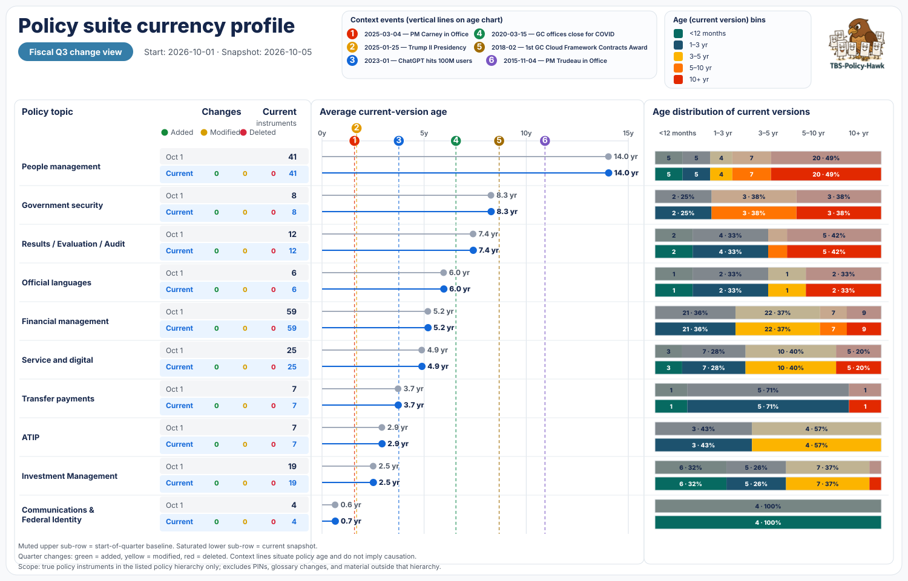
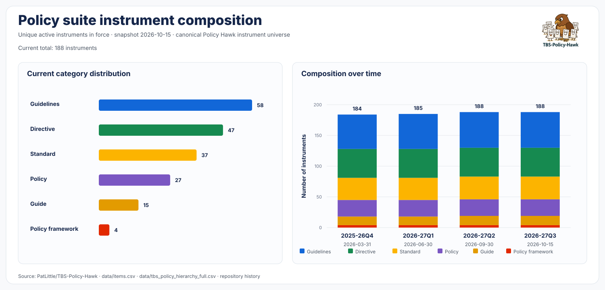

<!-- policy-hawk:banner -->

# Policy Evolution 2026-27 Q3

**Period covered:** 2026-10-01 to 2026-12-31 
**Source:** Auto-analysis comments added to TBS-Policy-Hawk issues.

This file compiles policy-change analysis comments for updates detected during the quarter. Entries are organized chronologically by the effective/update date in the issue GUID.

🚨 Issue Summaries and PolicyEvolution Reports are not official guidance, these analysis products use a mix of deterministic and generative techniques to indicate areas of change - ***A Place to Start Not The End of Understanding Policy Evolution***

<!-- policy-hawk:latest-heatmap -->

<!-- policy-hawk:currency-profile:start -->
## Policy suite currency profile

This quarter-level view tracks the **currency and change profile of the policy suite as a whole**. It is intentionally kept separate from the instrument-by-instrument analyses below.

<!-- policy-hawk:currency-profile-synopsis:start -->
### Currency profile synopsis

> **Scope note:** The Policy Suite currency profile includes only true policy instruments in the listed policy hierarchy. It excludes PINs, glossary changes, and anything outside that hierarchy.

The profile contains **188 current policy instruments** across the ten reporting topics. **Financial management** is the largest area with 59 instruments (31.4% of the suite), followed by **People management** with 41 (21.8%) and **Service and digital** with 25 (13.3%). Together, those three areas account for **66.5%** of current instruments. At the other end of the distribution, **Communications & Federal Identity** contains 4 instruments (2.1%).

The age profile differs sharply across topics. **People management** has the oldest current-version population, averaging **14.0 years**; 65.9% of its instruments are at least five years since their current version, including 48.8% at 10+ years. **Government security** also has a comparatively older profile at **8.3 years** on average, with 75.0% at five years or more. By contrast, **Communications & Federal Identity** averages just **0.7 years**, with 100.0% of instruments revised within the last three years; **Investment Management** is also relatively recent at **2.5 years** on average. These are differences in recency of the current versions, not assessments of policy quality or effectiveness.
<!-- policy-hawk:currency-profile-synopsis:end -->

- **Muted upper rows** show the start-of-quarter baseline (2026-10-01).
- **Saturated lower rows** show the current snapshot (2026-10-05).
- Quarter-to-date changes are shown as **added** (green), **modified** (yellow), and **deleted** (red) instruments.
- The lollipop chart compares average current-version age at the baseline and current snapshot.
- The distribution strips group current-version ages into `<12 months`, `1–3 years`, `3–5 years`, `5–10 years`, and `10+ years`.
- Vertical reference lines provide historical context only; they do **not** imply causation.

<!-- policy-hawk:currency-profile:end -->

<!-- policy-hawk:category-history:start -->
## Policy suite instrument composition

This view counts each **unique active policy instrument in force once**, using document ID as the identity key and the instrument's `category` at each reconstructed snapshot. It uses the same canonical Policy Hawk policy-instrument universe as the currency profile and excludes PINs, glossary changes, and non-instrument hierarchy nodes.

As of **2026-10-15**, the suite contains **188 instruments**: **Guidelines 58**, **Directive 47**, **Standard 37**, **Policy 27**, **Guide 15**, **Policy framework 4**.

### Instrument purpose, alignment and audience

Of the **188** instruments, **111 (59.0%) are mandatory** Policies, Directives or Standards; **73 (38.8%) are voluntary** Guidelines or Guides; and **4 (2.1%) are architectural Policy Frameworks**. By usual audience, **31 (16.5%)** are primarily executive/accountability-facing for Ministers and Deputy Heads, while **157 (83.5%)** are primarily implementation-facing for managers and functional specialists.

**Structural shift since 2026-27Q2:** none so far. The mandatory/voluntary balance and usual-audience mix are unchanged from the prior quarter-end snapshot.

> **Interpretation:** Policy Frameworks provide the strategic architecture and explain **why** Treasury Board sets policy in an area; Policies define **what** is expected and are mandatory; Directives and Standards provide mandatory **how** / operational requirements; Guidelines, Guides and Tools provide voluntary implementation guidance. Audience classifications describe the **usual primary audience**, not an exclusive readership.

The stacked bars show the category composition at each quarter-end snapshot available in Policy Hawk; the current quarter uses the latest available snapshot.

Although these are not official instruments in the Policy Suite, Policy Hawk also tracks **513 notices** in its PIN source collections as of **2026-10-15** ([current PIN_sources.md](PIN_sources.md)):

- Policy on Service and Digital Announcements (PSDA): **18**
- Contracting policy notices (CPN): **47**
- Access to Information and Privacy Notices (ATIPN): **24**
- Human Resources Information Notices (HRIN): **412**
- Security Policy Implementation Notice (SPIN): **6**
- Real Property Policy Notices (RPPN): **6**

<!-- policy-hawk:category-history:end -->

---

## 2026-10-01 — Direction on Government of Canada Cyber Security Readiness in the Frontier Artificial Intelligence Era: Security Policy Implementation Notice

**Issue:** [#521](https://github.com/PatLittle/TBS-Policy-Hawk/issues/521) 
**Notice identifier:** SPIN 2026-01 
**Category:** PIN / SPIN 
**GUID:** `pin_spin_ba14ee010f22_added_c118382e9adc_2026-10-01` 
**Change type:** pin added

### Policy change analysis

**Evidence:** The new repository capture is `data/PINs/changes/pin_spin_ba14ee010f22_added_c118382e9adc_2026-10-01/current.md`; `data/PINs/changes/pin_spin_ba14ee010f22_added_c118382e9adc_2026-10-01/previous.md` records no prior capture. The [direct Canada.ca notice](https://www.canada.ca/en/government/system/digital-government/policies-standards/spin/direction-government-canada-cyber-security-readiness-frontier-artificial-intelligence-era.html) returned HTTP 200 on 2026-10-02, with the same title, effective date, action codes and EPM deadline. This is an analysis of a newly captured notice, not a before/after amendment to an older local version.

#### Summary

SPIN 2026-01 took effect October 1, 2026. It reinforces existing Government Security and Service and Digital policy requirements with a phased set of cyber security actions focused first on critical services and resilience against AI-enabled threats. It applies to organizations covered by section 6 of the Policy on Government Security and spans federal networked assets, including on-premises and GC-managed cloud environments.

#### Operational direction

| Area | New direction | Practical effect |
|---|---|---|
| **Prioritization and deadline (IDT-1; 7.1–7.2)** | Rank critical services and their supporting systems; submit the prioritized list in TBS's EPM tool by **November 30, 2026**. Start with no more than three highest-priority services where capacity is limited, then extend the approach to remaining services. | Departments need an agreed critical-service scope and submission plan now; the three-service starting point is a recommended phasing method, not a permanent limit. |
| **Asset and exposure visibility (IDT-2–6)** | Maintain application inventories in APM, architecture diagrams, Internet-connection lists for NCTNS, and SBOMs for department-developed software supporting critical services; onboard endpoints to SSC EVA, prioritizing critical services. | Link service owners, assets, dependencies and external exposure so the most consequential gaps can be found and tracked. |
| **Vulnerabilities and identity (ACC-1–3; HRD-1–8)** | Triage alerts, accelerate risk-based patching for high-risk systems, use defensive AI safely, enforce MFA and least privilege, protect privileged and non-person identities, and update awareness exercises for AI-enabled impersonation. | Security and identity teams need shorter response cycles and explicit ownership for service accounts and AI agents. |
| **Containment and detection (FTY-1–5; MTR-1–3)** | Harden edge and remote access, control vendor access, segment critical systems, default-deny outbound Internet traffic in critical-service environments, protect administrator pathways, centralize tamper-resistant logs, and deploy EDR/XDR. | The notice turns the “assume breach” approach into layered controls that restrict lateral movement and support detection. |
| **Response and recovery (PRP-1–5)** | Align cyber event and business-continuity plans, exercise them, maintain response playbooks, test restores against known-good data, and separate/protect critical-service backups. | Departments should demonstrate that critical services can be contained and recovered, rather than relying on untested plans or backups. |
| **Third parties and oversight (7.3; 8; Appendix A)** | Carry relevant security requirements into contracts and ongoing management. TBS will verify exposed perimeter systems, monitor progress and engage senior officials where direction is unmet; Appendix A provides **notional** indicators. | Outsourcing does not remove departmental responsibility. The indicators guide monitoring and should not be read as additional fixed deadlines. |

#### Interpretation and watch item

The SPIN provides concrete implementation priorities and one explicit EPM submission deadline while leaving underlying policy obligations in force. Apart from November 30, several actions use terms such as “regularly,” “up-to-date,” or “where possible,” so the notice itself does not set a uniform completion date for every control. The detailed control and KPI lists in the captured notice remain the source for implementation planning; this summary does not replace them.

---

<!-- policy-hawk:issue-524:start -->
## 2026-10-05 — Amendments to the Directive on the Management of Real Property – Collection of Public Purpose Interests

**Issue:** [#524](https://github.com/PatLittle/TBS-Policy-Hawk/issues/524) 
**Notice identifier:** RPPN 2026-3 
**Affected document ID:** 32691 
**Category:** PIN / RPPN 
**GUID:** `pin_rppn_b907dc7ddc07_added_0467ac78b48f_2026-10-05` 
**Change type:** pin added

### Policy change analysis

#### Evidence and dates

- **Notice:** [RPPN 2026-3 — Collection of Public Purpose Interests](https://www.canada.ca/en/treasury-board-secretariat/services/federal-real-property-management/real-property-policy-notices/2026-3.html).
- **Current capture:** `data/PINs/changes/pin_rppn_b907dc7ddc07_added_0467ac78b48f_2026-10-05/current.md`.
- **Previous notice evidence:** `data/PINs/changes/pin_rppn_b907dc7ddc07_added_0467ac78b48f_2026-10-05/previous.md` records “No previous capture.” This establishes a newly captured notice, not a proven first publication date.
- **Affected instrument:** Directive on the Management of Real Property (32691), Appendix F. Closest pre-amendment capture: `data/Directive/32691_2026-07-24/20260725T014912Z.md`. The post-amendment text is preserved in [issue #520’s current-version comment](https://github.com/PatLittle/TBS-Policy-Hawk/issues/520#issuecomment-5898127044); the September 29 XML file contains a request-rejection page and is unsuitable for substantive comparison.
- **Notice date and amendment effective date:** September 21, 2026. **Detection/GUID and page-modified date:** October 5, 2026.
- **Live-source check, October 5, 2026:** the direct notice returned HTTP 200 with substantive text matching the capture. The separate directive fetch returned “Request Rejected”; independent live verification of that instrument remains indeterminate.

#### Summary

RPPN 2026-3 explains the September 21 amendment already analyzed in [#520](https://github.com/PatLittle/TBS-Policy-Hawk/issues/520). Departments may collect public-purpose interests sequentially or simultaneously. The notice makes departmental accountability, adherence to the existing priority order for sequential collection, and documentation of the chosen method explicit.

This is implementation direction for a **mandatory Directive**, primarily relevant to real-property practitioners and managers. It does not create a new policy instrument or demonstrate a second amendment in October.

#### Substantive changes and implementation direction

| Area | Evidence before / previous state | Evidence now | Interpretation |
|---|---|---|---|
| **F.2.2 — Collection method** | July 24 capture required simultaneous collection from federal departments, agent Crown corporations, provinces, municipalities and Indigenous groups. | September directive capture allows simultaneous or sequential collection; the notice confirms that choice. | Departments can adapt collection to the transaction. Faster disposal is an intended or possible effect, not a measured outcome. |
| **Sequential collection and F.2.3** | F.2.3 already established acquisition priorities; the amended F.2.2 permits omission of lower-priority interests when disposing for public purpose to a higher-priority group. | The notice expressly requires sequential collection to follow F.2.3’s order of precedence. | The method is discretionary, but priority compliance is not. For other public purposes, the captured order is federal departments, agent Crown corporations, provinces, then municipalities and Indigenous groups at the same tier. F.2.3 separately retains housing-development priority in any order. |
| **Departmental accountability** | No prior local notice exists; the amended F.2.2 itself does not specify how to justify the method selected. | The notice assigns the choice to the department and requires it to reflect the transaction’s circumstances and characteristics. | The department must exercise and support its judgment; the notice does not establish a new TBS approval step. |
| **Rationale and due diligence** | #520 recommended retaining a clear implementation record; that analysis did not identify a new documentation clause in F.2.2. | The notice explicitly directs departments to maintain adequate documentation of why collection is sequential or simultaneous and to complete required due diligence. | Documentation is now explicit in the notice’s operational direction, including for simultaneous collection. The wording presents these responsibilities as continuing; no prior notice supports claiming that the underlying obligation originated here. |

#### Practical effect

1. **Record the choice:** Explain the selected collection method against the characteristics of each transaction. For sequential collection, retain evidence of the priority followed and, where applicable, the condition permitting collection from lower-priority groups to stop.
2. **Use the correct disposal route:** Appendix F concerns disposals not intended to support housing development. The notice does not replace Appendix E’s housing procedures; E.2.2.6 can route housing-suitable property to Appendix F when the intended disposal is not to support housing.
3. **Retain safeguards:** A collection exception is not a general exemption from due diligence or separate Indigenous and official-language consultation obligations. The notice adds no new numerical threshold, reporting deadline or implementation grace period.
4. **Avoid double counting:** Include this newly captured PIN in the Q3 report by its October 5 GUID date, with the September 21 effective date stated. The underlying directive amendment remains the Q2 event analyzed in #520; the PIN is excluded from the instrument composition and currency-profile population.

#### Watch item

Update disposal procedures and decision-record templates to reflect the notice’s explicit rationale-documentation direction. Keep collection of public-purpose interests distinct from any separate duty to consult. The notice does not state that it supersedes another notice, and the absence of a previous capture cannot establish the first publication date.

#### Classification

`pin-update`; `scope-change` — confirms the F.2.2 collection flexibility and conditional lower-priority exception already analyzed in #520, with explicit implementation accountability and documentation direction.

<!-- policy-hawk:issue-524:end -->

---

<!-- policy-hawk:issue-525:start -->
## 2026-10-14 — Leave without pay (LWOP) for compassionate caregiving – Temporary changes to approval process

**Issue:** [#525](https://github.com/PatLittle/TBS-Policy-Hawk/issues/525) 
**Category:** PIN / HRIN 
**GUID:** `pin_hrin_67aec9a3b5fc_changed_c97215a58d52_2026-10-14` 
**Change type:** pin changed

### Policy change analysis

Compared the October 14 HRIN capture with the closest prior repository copy (captured August 26):

- Current: `data/PINs/changes/pin_hrin_67aec9a3b5fc_changed_c97215a58d52_2026-10-14/current.md`
- Previous: `data/PINs/changes/pin_hrin_67aec9a3b5fc_changed_c97215a58d52_2026-10-14/previous.md`
- [Live Canada.ca notice](https://www.canada.ca/en/treasury-board-secretariat/services/information-notice/leave-without-pay-compassionate-caregiving-temporary-changes-approval-process.html) checked October 15, 2026; its Pay Centre links match the current capture.

#### Summary

The notice's two Pay Centre links now point to the current Canada.ca contact page. The 2021 compassionate-caregiving leave direction and the steps for managers and compensation advisors are unchanged. The notice's page-modified metadata moved from July 17, 2024 to October 14, 2026; that date change alone does not create a new policy requirement.

| Area | Previous capture | Current capture | Interpretation |
|---|---|---|---|
| **Manager step 2 and Additional information** | Pay Centre links used the older PSPC contact URL. | Both links use the Canada.ca Pay Centre contact URL. | Contact/navigation update only; managers still submit GC-178 to the Pay Centre or departmental compensation advisor through the regular process. |
| **Approval and pension process** | Manager records the applicable collective-agreement reference on GC-178; compensation advisor sends the form to the Pension Centre. | Same wording and responsibilities. | No change to eligibility, contributions, approval route, deadline, or form handling. |

**Practical effect:** Update any local bookmarks to the Pay Centre contact page. Continue to follow the notice's existing GC-178 process. **Classification:** `reference-update`, `administrative-cleanup`; no substantive policy impact found.

<!-- policy-hawk:issue-525:end -->

---

<!-- policy-hawk:issue-526:start -->
## 2026-10-14 — Temporary change in process: Group insurance benefit plans administration

**Issue:** [#526](https://github.com/PatLittle/TBS-Policy-Hawk/issues/526) 
**Category:** PIN / HRIN 
**GUID:** `pin_hrin_4010e898044e_changed_30fa303847d0_2026-10-14` 
**Change type:** pin changed

### Policy change analysis

Compared the October 14 HRIN capture with the closest prior repository copy (captured August 26):

- Current: `data/PINs/changes/pin_hrin_4010e898044e_changed_30fa303847d0_2026-10-14/current.md`
- Previous: `data/PINs/changes/pin_hrin_4010e898044e_changed_30fa303847d0_2026-10-14/previous.md`
- [Live Canada.ca notice](https://www.canada.ca/en/treasury-board-secretariat/services/information-notice/group-insurance-benefit-plans-administration-public-service-pay-centre-2016.html) checked October 15, 2026; it contains the same changed sentence as the current capture.

#### Summary

The Public Service Health Care Plan application instruction has been shortened from “use Phoenix self service first; if unavailable, contact the Pay Centre by feedback form or phone” to “use the phone.” The page still says, immediately above, that a completed Phoenix self-service application or employee form can establish coverage timing. The conflict makes the new sentence a **possible publication regression**, not reliable evidence that Phoenix self service has been withdrawn. Other temporary group-insurance measures are unchanged.

| Area | Previous capture | Current capture | Interpretation |
|---|---|---|---|
| **PSHCP, application route (item 1.b)** | Apply or change coverage first through Phoenix self service; if unavailable, contact the Pay Centre using its Phoenix feedback form or phone. | “Applicants should first apply to the PSHCP or make changes to their coverage using the phone.” The phone link now points to the Canada.ca Pay Centre contact page. | Removes the explicit first-choice self-service instruction and feedback-form option from this sentence. “Using the phone” is awkward and conflicts with item 1.a; seek source-owner clarification before changing procedures. |
| **PSHCP, coverage timing (item 1.a)** | Completed Phoenix self-service application or TBS-006491 form determines the effective date, subject to the retroactivity rule. | Same wording. | The notice still recognizes Phoenix self-service applications; no supported change to the effective-date rule. |
| **Other plan measures** | PSHCP waiting-period and retroactivity provisions, LWOP coverage, dental reinstatement and basic-life insurance provisions. | Same wording. | No detected change to eligibility, contribution recovery, thresholds, or deadlines. |

**Practical effect:** Flag item 1.b to the notice owner for correction or clarification. Until clarified, do not infer from this one inconsistent sentence that Phoenix self service is unavailable or that phone contact alone constitutes a completed application. **Classification:** `pin-update`, `possible-regression`, `reference-update`. The page-modified date changed from September 9, 2020 to October 14, 2026; that metadata change has no separate policy effect.

<!-- policy-hawk:issue-526:end -->

---

<!-- policy-hawk:issue-528:start -->
## 2026-10-22 — Cabinet Directive on Getting Projects Built in Canada (2026)

**Issue:** [#528](https://github.com/PatLittle/TBS-Policy-Hawk/issues/528)  
**Category:** Cabinet Directive  
**GUID:** `cabdir_433c77569dfcc13b_2026-10-22_b83c88395fe5af7c`  
**Change type:** cabinet_newly_captured

### Policy change analysis

<!-- cabinet:evidence -->
Compared the Cabinet Directive evidence for `cabdir_433c77569dfcc13b_2026-10-22_b83c88395fe5af7c`:

- Current capture: `data/CabinetDirectives/changes/cabdir_433c77569dfcc13b_2026-10-22_b83c88395fe5af7c/current.md`
- Prior capture: No prior local copy; this is a baseline capture, not a verified amendment comparison.
- Required screenshot: `screenshots/cabdir_433c77569dfcc13b_2026-10-22_b83c88395fe5af7c_current.png`

#### Summary

The directive, dated September 21, 2026, is newly captured by Policy Hawk on October 22. It sets a one-year federal project-decision expectation, coordinated permitting and consultation arrangements, and reporting responsibilities. It expressly replaces the 2024 clean-growth directive, but the earlier text is not captured here, so the extent of changes from that predecessor cannot be established from this evidence alone.

#### Substantive changes identified

| Section | Prior evidence | Current direction | Interpretation |
|---|---|---|---|
| Context | No prior local copy | Names the 2024 Cabinet Directive on Regulatory and Permitting Efficiency for Clean Growth Projects as its predecessor. | Replacement is expressly stated; a detailed amendment comparison requires the 2024 text. |
| Section 3: review targets | No prior local copy | Departments are expected to structure reviews for decisions within one year after receipt of a comprehensive application and required information/studies. Existing projects are assessed case by case. | An operational policy expectation with prerequisites and transitional treatment; this does not itself create or amend a statutory deadline. |
| Section 2: application | No prior local copy | Excludes independent/arm's-length decision functions, offshore regulators and modern treaty co-management boards from the stated application. Timeliness/process provisions do not apply to Indian Act authorizations; statutory powers and treaty obligations are preserved. | The one-year expectation must be read with these limits, rather than applied to every federal decision. |
| Sections 4–6: coordination | No prior local copy | Defines MPO coordination, the IAAC President's Federal Review Coordinator role, a Crown Consultation Hub, and deputy-minister oversight. Section 5.3 provides separate coordination arrangements for specified CER/CNSC and transportation cases. | Identifies who coordinates reviews and consultations, subject to the distinct roles and authorities in the directive. |
| Section 7: reporting | No prior local copy | Departments and IAAC report through regular Parliamentary reporting; IAAC indicators cover coordinated permit decisions and consultations. | Existing direction in this baseline provides concrete measures to monitor; its novelty against 2024 is unverified. |

#### Practical effect

1. Plan review and permit work around a complete application and required studies, concurrent processes where applicable, and the one-year decision expectation.
2. Coordinate proponents, departments and Indigenous consultation through the applicable structures while preserving statutory discretion, modern treaty obligations and application exclusions.
3. Track decision and consultation results through the reporting arrangements. Treat application to projects already under review as case specific.

#### Non-substantive changes

This is the first local capture. No intervening text amendment is demonstrated. Publication, capture, effective and page-modified dates are separate; the source does not separately establish an effective date in this capture.

#### Watch item

Obtain the 2024 predecessor before claiming specific additions or removals. Monitor implementation guidance and evidence on how application completeness, exceptions, case-specific transitions and reporting are handled.

<!-- policy-hawk:issue-528:end -->

---
---

<!-- policy-hawk:issue-527:start -->
## 2026-10-22 — Cabinet Directive on Regulatory Competitiveness and Red Tape Reduction

**Issue:** [#527](https://github.com/PatLittle/TBS-Policy-Hawk/issues/527)  
**Category:** Cabinet Directive  
**GUID:** `cabdir_5100844d79f6319c_2026-10-22_0528dd23f0c7a711`  
**Change type:** cabinet_replacement

### Policy change analysis

<!-- cabinet:evidence -->
Compared the announced Cabinet Directive replacement for `cabdir_5100844d79f6319c_2026-10-22_0528dd23f0c7a711`:

- Current capture: `data/CabinetDirectives/changes/cabdir_5100844d79f6319c_2026-10-22_0528dd23f0c7a711/current.md`
- Prior capture: `data/CabinetDirectives/changes/cabdir_5100844d79f6319c_2026-10-22_0528dd23f0c7a711/previous.md`
- Required screenshots: `screenshots/cabdir_5100844d79f6319c_2026-10-22_0528dd23f0c7a711_previous.png` and `screenshots/cabdir_5100844d79f6319c_2026-10-22_0528dd23f0c7a711_current.png`

#### Summary

This is an announced replacement, published October 21, 2026, which will take effect on December 31, 2026. The Cabinet Directive on Regulation remains In Force at the October 22 capture date. Compared with the archived CDR text, the successor adds explicit competitiveness-assessment and burden-offset direction, specified regulatory-stock review intervals, and revised standards and Indigenous-policy references, while presenting a shorter framework. It does not itself amend statutes or existing regulations.

#### Substantive changes identified

| Area | CDR before-state | Announced successor | Interpretation |
|---|---|---|---|
| Commencement | Section 9.0 gives September 1, 2018 as CDR's effective date. Its notice announces future replacement. | Section 6 establishes December 31, 2026 commencement and replacement of the 2018 CDR. | Record the successor as Announced, not yet In Force; do not mark CDR Superseded prematurely. |
| Competitiveness | Principles and impact analysis already address a competitive economy, benefits/costs and regulatory cooperation. | Section 3.2 specifies a dedicated competitiveness-impact assessment and communication of its results. | Adds an explicit assessment-and-communication priority; competitiveness was not absent from CDR. |
| Burden offsets | Section 5.2.4 refers to the statutory One-for-One Rule and administrative-burden estimates. | Section 3.3 specifies a $2 offset per $1 increase in regulatory burden on business over three years, as defined by TBS. | Distinguish the policy direction's measures and time period from the existing statutory rule; the directive alone does not rewrite the Act or Regulations. |
| Regulatory review | Section 7.2 requires regular stock review and departmental review timelines without the successor's specified intervals. | Section 3.5 calls for significant-impact measures, as defined by TBS, to be reviewed within five years of coming into force and other regulations at least every ten years. | Provides explicit review intervals; implementation depends on the stated definitions and supporting direction. |
| Standards | Sections 4.2, 5.2.5 and 5.2.6 address cooperation, possible alignment and incorporation by reference. | Section 3.4 calls for considering and, where appropriate, adopting recognized standards by default, with evidence-based adaptation for Canada when warranted in the public interest. | Changes the stated policy approach while retaining qualifications and statutory constraints. |
| Procedure and roles | CDR contains detailed analytical/publication provisions, 30-day and possible 70-day consultation periods, explicit GBA+ direction, and a multi-institution appendix. | The shorter text retains proportionate impact analysis, significant-impact pre-publication or exemption, and regulator/TBS roles; section 5.2.3 authorizes supporting TBS policies, guidance, tools and processes. | Some detail is absent from the successor's body. Do not infer that GBA+, consultation periods or statutory institutional responsibilities have been withdrawn without checking the continuing legal and policy framework. |
| Indigenous obligations | CDR addresses consultation/accommodation, modern treaty implications and relevant rights. | Section 4.5 expressly references distinctions among First Nations, Inuit and Métis, the UN Declaration Act, treaties/self-government agreements and the Inuit Nunangat Policy directive; section 2.3 preserves authorities and obligations. | Expands the text's explicit references; this wording does not itself establish new underlying legal rights or authorities. |

#### Practical effect

1. Prepare for the December transition by aligning assessment, communication, burden measurement and stock-review planning with forthcoming TBS definitions and guidance.
2. Continue applying currently operative requirements. Treat the announced framework as policy direction that remains subject to legislation, international obligations and other applicable instruments.
3. Check supporting policies before interpreting the shorter text as removing a detailed analytical, consultation or institutional requirement.

#### Non-substantive changes

Headings, numbering and organization are substantially condensed. Renumbering alone is not substantive, but shorter text and omitted detail cannot automatically be classified as mere formatting or confirmed rescission.

#### Watch item

Verify the TBS definitions and implementation rules for competitiveness assessment, regulatory burden offsets and significant-impact measures. Check the continuity or revision of GBA+, consultation periods and other detailed requirements. Confirm the replacement has taken effect before changing the register's statuses.

<!-- policy-hawk:issue-527:end -->

---
---
<!-- policy-hawk:issue-530:start -->
## 2026-10-22 — Cabinet Directive on Strategic Environmental and Economic Assessment (SEEA)

**Issue:** [#530](https://github.com/PatLittle/TBS-Policy-Hawk/issues/530)  
**Category:** Cabinet Directive  
**GUID:** `cabdir_cc6dea83d9724ab6_2026-10-22_cc21f42de7d4ccf8`  
**Change type:** cabinet_newly_captured

### Policy change analysis

<!-- cabinet:evidence -->
Compared the Cabinet Directive evidence for `cabdir_cc6dea83d9724ab6_2026-10-22_cc21f42de7d4ccf8`:

- Current capture: `data/CabinetDirectives/changes/cabdir_cc6dea83d9724ab6_2026-10-22_cc21f42de7d4ccf8/current.md`
- Prior capture: No prior local copy; baseline capture.
- Required screenshot: `screenshots/cabdir_cc6dea83d9724ab6_2026-10-22_cc21f42de7d4ccf8_current.png`

#### Summary

The SEEA directive was published April 2, 2024 and is newly captured on October 22, 2026. With no prior local version, no intervening amendment is established. Its existing direction integrates environmental and economic considerations into specified Cabinet, regulatory and funding proposals, with assessment triggers, exemptions, central-agency checks and public reporting.

#### Substantive changes identified

| Section | Prior evidence | Existing direction in the capture | Interpretation |
|---|---|---|---|
| Sections 2.1–2.2 | No prior local copy | Applies to Memoranda to Cabinet, Treasury Board submissions, regulatory proposals subject to CDR, and funding requests to the Prime Minister and Minister of Finance. Allows whole-directive exemptions for immediate emergencies, qualifying routine/administrative proposals and specified federal assessment processes. | Identify the proposal route and applicable exemption before determining assessment work. This is separate from project-level impact assessment. |
| Sections 2.3–2.4 | No prior local copy | Exempts CDR regulatory proposals from economic-analysis elements; also permits economic-only exemptions for proposals already assessed by Finance pursuant to a ministerial request or another process. | An economic-analysis exemption does not automatically remove environmental-analysis obligations. |
| Sections 4.1–4.3 | No prior local copy | Screens environmental and economic effects. Important environmental effects trigger strategic environmental analysis under 4.2; important economic effects trigger analysis under 4.3, with proportionate detail. | Explains the existing triggers and required analytical coverage, rather than assuming every proposal requires the same detailed assessment. |
| Sections 3.5–3.6 and 4.4–4.6 | No prior local copy | Requires records of assessments/exemptions, integration during proposal development and reflection of findings/trade-offs in proposals; central agencies confirm completion and appropriate reflection of findings. | Establishes an auditable assessment-to-decision trail in this baseline. |
| Sections 5.1–5.4 | No prior local copy | Requires public statements after announcement or implementation for proposals with detailed analysis under 4.2 or 4.3; reporting on practices uses departmental sustainable-development reporting. | Public-statement requirements follow the detailed-assessment trigger; they are not automatically imposed on every screened proposal. |

#### Practical effect

1. Screen the proposal, record any applicable exemption, and conduct detailed environmental or economic analysis when the relevant important-effects trigger is met.
2. Integrate findings and trade-offs into the decision proposal and retain records for departmental and central-agency checks.
3. Plan public statements and departmental reporting where required. The capture date does not restart assessment or reporting timelines.

#### Non-substantive changes

This first local capture records existing published direction. There is no before-state establishing a new obligation or amendment. The April 2 publication date and May 10 page-modified date do not independently establish an effective date.

#### Watch item

Monitor supporting assessment guidance and the distinction between whole-directive and economic-only exemptions. Obtain an earlier version before characterizing changes from the former Strategic Environmental Assessment directive.

<!-- policy-hawk:issue-530:end -->

---
---

<!-- policy-hawk:issue-532:start -->
## 2026-10-22 — Cabinet Directive on the Coordinated Response to Threats to Elections (CRTE)

**Issue:** [#532](https://github.com/PatLittle/TBS-Policy-Hawk/issues/532)  
**Category:** Cabinet Directive  
**GUID:** `cabdir_6017e4e2aec1da6e_2026-10-22_c37f62a9eccac764`  
**Change type:** cabinet_newly_captured

### Policy change analysis

<!-- cabinet:evidence -->
Compared the Cabinet Directive evidence for `cabdir_6017e4e2aec1da6e_2026-10-22_c37f62a9eccac764`:

- Current capture: `data/CabinetDirectives/changes/cabdir_6017e4e2aec1da6e_2026-10-22_c37f62a9eccac764/current.md`
- Prior capture: No prior local copy; baseline capture.
- Required screenshot: `screenshots/cabdir_6017e4e2aec1da6e_2026-10-22_c37f62a9eccac764_current.png`

#### Summary

The CRTE directive, published March 26, 2026, is newly captured on October 22. No comparative amendment can be established without an earlier local copy. It describes a non-partisan panel's coordinated response to threats to free and fair federal general elections during caretaker periods, with preparatory work outside those periods and specific communication and reporting requirements.

#### Substantive changes identified

| Section | Prior evidence | Existing direction in the capture | Interpretation |
|---|---|---|---|
| Sections 1–3: purpose and scope | No prior local copy | Limits the incident-response mandate to caretaker-period incidents outside Elections Canada's election-administration responsibilities. The directive is not in effect for by-elections; it also specifies outside-period preparation and communication activities. | Preserve the general-election/caretaker boundaries without overlooking the express preparatory functions. |
| Sections 4.1–4.3: panel | No prior local copy | Names five senior officials and an external member, with reasonable efforts to appoint the external member; the panel can operate without that appointment. Requires non-partisanship and consensus. | An external vacancy does not by itself suspend panel operations. These are baseline governance provisions, not verified 2026 amendments. |
| Section 5: response | No prior local copy | Coordinates briefings, incident reporting and potential responses using existing government tools and authorities. | Coordination does not itself confer new enforcement powers. |
| Section 6: communications | No prior local copy | Specifies a statement within a week of the writs; public intervention requires careful consideration and a high threshold. Before a public announcement, designated leaders and Elections Canada are informed and party leaders receive the same briefing information. | Distinguish routine election-period communication from the higher-threshold incident announcement process. |
| Sections 8–9: authorities and reporting | No prior local copy | Preserves existing mandates and RCMP independence. Requires a post-election report to the Prime Minister and NSICOP, with a public version. | The source provides explicit authority limits and accountability requirements. |

#### Practical effect

1. Maintain panel readiness and incident-reporting channels while applying the caretaker-period and mandate boundaries.
2. Assess response and public-communication options using the directive's consensus, threshold and advance-notification arrangements.
3. Prepare the post-election report and public version. First repository capture does not establish whether any particular election's duties have been completed.

#### Non-substantive changes

This is an initial repository baseline, not an evidenced amendment. Publication and page-modified dates are separate from capture; no independent effective date is established in the archived text.

#### Watch item

Monitor the external-member appointment, published post-election reports and any changes to communication thresholds or scope. Do not infer new enforcement authority, apply the caretaker incident mechanism to by-elections, or treat a panel vacancy as ending the directive's application.

<!-- policy-hawk:issue-532:end -->

---
---
<!-- policy-hawk:issue-531:start -->
## 2026-10-22 — Cabinet Directive on the Federal Approach to Modern Treaty Implementation

**Issue:** [#531](https://github.com/PatLittle/TBS-Policy-Hawk/issues/531)  
**Category:** Cabinet Directive  
**GUID:** `cabdir_41f70790033ad712_2026-10-22_8919ff389563ecb7`  
**Change type:** cabinet_newly_captured

### Policy change analysis

<!-- cabinet:evidence -->
Compared the Cabinet Directive evidence for `cabdir_41f70790033ad712_2026-10-22_8919ff389563ecb7`:

- Current capture: `data/CabinetDirectives/changes/cabdir_41f70790033ad712_2026-10-22_8919ff389563ecb7/current.md`
- Prior capture: No prior local copy; baseline capture.
- Required screenshot: `screenshots/cabdir_41f70790033ad712_2026-10-22_8919ff389563ecb7_current.png`

#### Summary

This first repository capture records the federal operational framework for modern treaty implementation, published July 9, 2015. No intervening amendment is demonstrated. The source assigns departmental responsibilities, modern treaty implication assessments, coordination, monitoring and reporting roles, using the historical institutional name Aboriginal Affairs and Northern Development Canada (AANDC).

#### Substantive changes identified

| Section | Prior evidence | Existing direction in the capture | Interpretation |
|---|---|---|---|
| Section 1: departments and agencies | No prior local copy | Requires awareness and fulfilment of treaty obligations, treaty-compliant activities, annual reporting contributions and participation in relevant governance structures. | The directive operationalizes existing treaty responsibilities; this capture does not create the underlying treaty rights. |
| Section 1: Assessment of Modern Treaty Implications | No prior local copy | Calls for consideration of treaty implications on Cabinet proposals and specifies an assessment where the proposal goes to Cabinet and implementation may affect modern treaties and the rights they contain. | Preserve the stated conditions and distinguish consideration/screening from the specified assessment requirement. |
| Section 1: central agencies, Justice and AANDC | No prior local copy | Assigns central-agency confirmation before Cabinet referral, Justice legal advice, AANDC coordination and administration of the Treaty Obligation Monitoring System. | Records allocated functions in the published text; historical naming alone does not establish today's institutional allocation or system operation. |
| Sections 2–3 | No prior local copy | Provides for a deputy-minister oversight committee and a Modern Treaty Implementation Office, including performance measurement, annual reports and issue coordination. | Describes the source's governance framework; first capture does not prove these bodies were newly created in 2026. |
| Section 4 | No prior local copy | Specifies evaluation within five years of implementation. | This is a historical, implementation-relative requirement. The October 2026 capture does not start a fresh five-year period, and the capture alone does not show whether the evaluation occurred. |

#### Practical effect

1. Identify applicable modern treaty obligations when developing proposals and complete the specified implications assessment where the source's conditions apply.
2. Document compliance, coordinate across responsible departments and contribute to monitoring and annual reporting under the published framework.
3. Confirm current institutional contacts and implementation guidance when using the text's historical departmental names.

#### Non-substantive changes

The repository has newly archived the published text; there is no earlier local capture establishing an amendment. The source's July 2015 publication date and February 2023 page-modified date are distinct from capture and do not independently establish commencement.

#### Watch item

Verify current responsibility for the functions named under AANDC, the status of the monitoring and governance arrangements, and any published evaluation. Avoid interpreting unchanged historical wording as evidence of a new office or a future five-year deadline.

<!-- policy-hawk:issue-531:end -->

---
---
