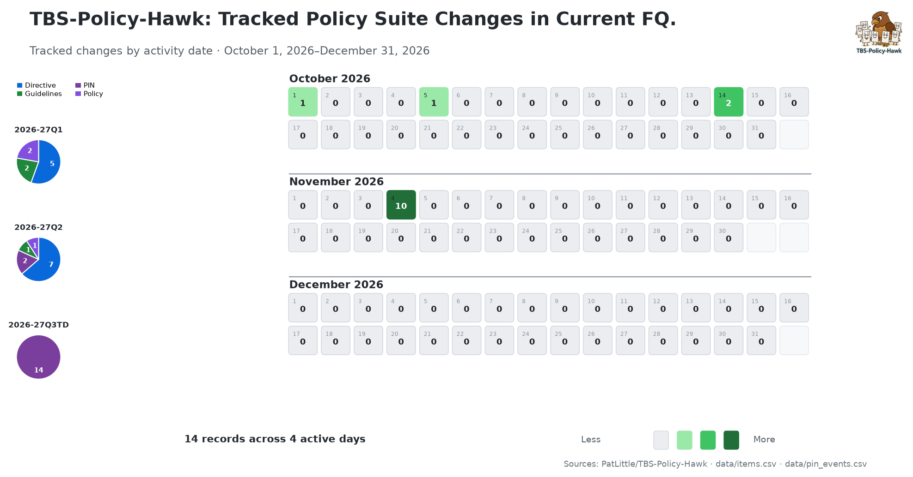
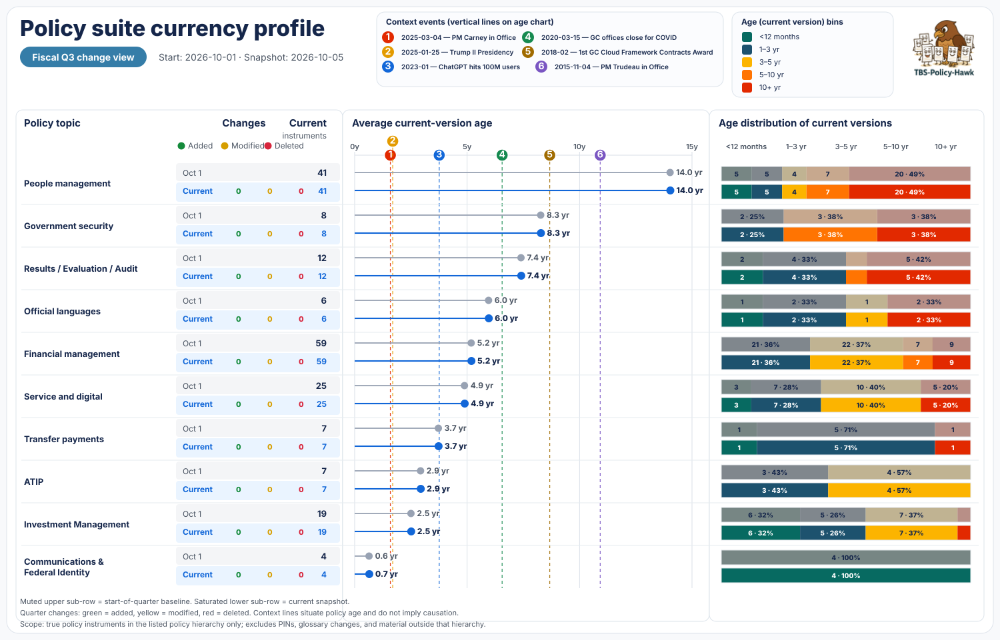
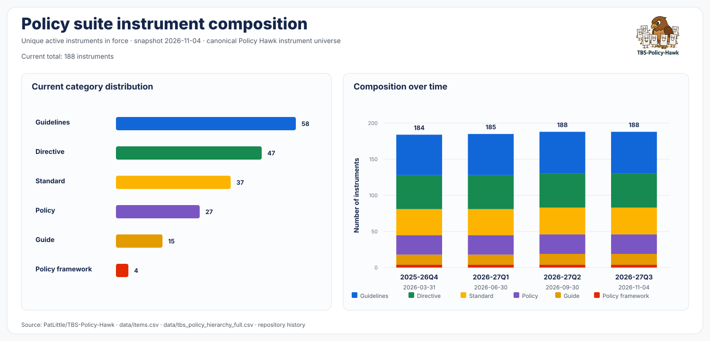

<!-- policy-hawk:banner -->

# Policy Evolution 2026-27 Q3

**Period covered:** 2026-10-01 to 2026-12-31 
**Source:** Auto-analysis comments added to TBS-Policy-Hawk issues.

This file compiles policy-change analysis comments for updates detected during the quarter. Entries are organized chronologically by the supported change or publication date. New collection baselines are not quarterly policy events.

🚨 Issue Summaries and PolicyEvolution Reports are not official guidance, these analysis products use a mix of deterministic and generative techniques to indicate areas of change - ***A Place to Start Not The End of Understanding Policy Evolution***

<!-- policy-hawk:latest-heatmap -->

<!-- policy-hawk:currency-profile:start -->
## Policy suite currency profile

This quarter-level view tracks the **currency and change profile of the policy suite as a whole**. It is intentionally kept separate from the instrument-by-instrument analyses below.

<!-- policy-hawk:currency-profile-synopsis:start -->
### Currency profile synopsis

> **Scope note:** The Policy Suite currency profile includes only true policy instruments in the listed policy hierarchy. It excludes PINs, glossary changes, and anything outside that hierarchy.

The profile contains **188 current policy instruments** across the ten reporting topics. **Financial management** is the largest area with 59 instruments (31.4% of the suite), followed by **People management** with 41 (21.8%) and **Service and digital** with 25 (13.3%). Together, those three areas account for **66.5%** of current instruments. At the other end of the distribution, **Communications & Federal Identity** contains 4 instruments (2.1%).

The age profile differs sharply across topics. **People management** has the oldest current-version population, averaging **14.0 years**; 65.9% of its instruments are at least five years since their current version, including 48.8% at 10+ years. **Government security** also has a comparatively older profile at **8.3 years** on average, with 75.0% at five years or more. By contrast, **Communications & Federal Identity** averages just **0.7 years**, with 100.0% of instruments revised within the last three years; **Investment Management** is also relatively recent at **2.5 years** on average. These are differences in recency of the current versions, not assessments of policy quality or effectiveness.
<!-- policy-hawk:currency-profile-synopsis:end -->

- **Muted upper rows** show the start-of-quarter baseline (2026-10-01).
- **Saturated lower rows** show the current snapshot (2026-10-05).
- Quarter-to-date changes are shown as **added** (green), **modified** (yellow), and **deleted** (red) instruments.
- The lollipop chart compares average current-version age at the baseline and current snapshot.
- The distribution strips group current-version ages into `<12 months`, `1–3 years`, `3–5 years`, `5–10 years`, and `10+ years`.
- Vertical reference lines provide historical context only; they do **not** imply causation.

<!-- policy-hawk:currency-profile:end -->

<!-- policy-hawk:category-history:start -->
## Policy suite instrument composition

This view counts each **unique active policy instrument in force once**, using document ID as the identity key and the instrument's `category` at each reconstructed snapshot. It uses the same canonical Policy Hawk policy-instrument universe as the currency profile and excludes PINs, glossary changes, and non-instrument hierarchy nodes.

As of **2026-11-05**, the suite contains **188 instruments**: **Guidelines 58**, **Directive 47**, **Standard 37**, **Policy 27**, **Guide 15**, **Policy framework 4**.

### Instrument purpose, alignment and audience

Of the **188** instruments, **111 (59.0%) are mandatory** Policies, Directives or Standards; **73 (38.8%) are voluntary** Guidelines or Guides; and **4 (2.1%) are architectural Policy Frameworks**. By usual audience, **31 (16.5%)** are primarily executive/accountability-facing for Ministers and Deputy Heads, while **157 (83.5%)** are primarily implementation-facing for managers and functional specialists.

**Structural shift since 2026-27Q2:** none so far. The mandatory/voluntary balance and usual-audience mix are unchanged from the prior quarter-end snapshot.

> **Interpretation:** Policy Frameworks provide the strategic architecture and explain **why** Treasury Board sets policy in an area; Policies define **what** is expected and are mandatory; Directives and Standards provide mandatory **how** / operational requirements; Guidelines, Guides and Tools provide voluntary implementation guidance. Audience classifications describe the **usual primary audience**, not an exclusive readership.

The stacked bars show the category composition at each quarter-end snapshot available in Policy Hawk; the current quarter uses the latest available snapshot.

Although these are not official instruments in the Policy Suite, Policy Hawk also tracks **513 notices** in its PIN source collections as of **2026-11-05** ([current PIN_sources.md](PIN_sources.md)):

- Policy on Service and Digital Announcements (PSDA): **18**
- Contracting policy notices (CPN): **47**
- Access to Information and Privacy Notices (ATIPN): **24**
- Human Resources Information Notices (HRIN): **412**
- Security Policy Implementation Notice (SPIN): **6**
- Real Property Policy Notices (RPPN): **6**

<!-- policy-hawk:category-history:end -->

---

## 2026-10-01 — Direction on Government of Canada Cyber Security Readiness in the Frontier Artificial Intelligence Era: Security Policy Implementation Notice

**Issue:** [#521](https://github.com/PatLittle/TBS-Policy-Hawk/issues/521) 
**Notice identifier:** SPIN 2026-01 
**Category:** PIN / SPIN 
**GUID:** `pin_spin_ba14ee010f22_added_c118382e9adc_2026-10-01` 
**Change type:** pin added

### Policy change analysis

**Evidence:** The new repository capture is `data/PINs/changes/pin_spin_ba14ee010f22_added_c118382e9adc_2026-10-01/current.md`; `data/PINs/changes/pin_spin_ba14ee010f22_added_c118382e9adc_2026-10-01/previous.md` records no prior capture. The [direct Canada.ca notice](https://www.canada.ca/en/government/system/digital-government/policies-standards/spin/direction-government-canada-cyber-security-readiness-frontier-artificial-intelligence-era.html) returned HTTP 200 on 2026-10-02, with the same title, effective date, action codes and EPM deadline. This is an analysis of a newly captured notice, not a before/after amendment to an older local version.

#### Summary

SPIN 2026-01 took effect October 1, 2026. It reinforces existing Government Security and Service and Digital policy requirements with a phased set of cyber security actions focused first on critical services and resilience against AI-enabled threats. It applies to organizations covered by section 6 of the Policy on Government Security and spans federal networked assets, including on-premises and GC-managed cloud environments.

#### Operational direction

| Area | New direction | Practical effect |
|---|---|---|
| **Prioritization and deadline (IDT-1; 7.1–7.2)** | Rank critical services and their supporting systems; submit the prioritized list in TBS's EPM tool by **November 30, 2026**. Start with no more than three highest-priority services where capacity is limited, then extend the approach to remaining services. | Departments need an agreed critical-service scope and submission plan now; the three-service starting point is a recommended phasing method, not a permanent limit. |
| **Asset and exposure visibility (IDT-2–6)** | Maintain application inventories in APM, architecture diagrams, Internet-connection lists for NCTNS, and SBOMs for department-developed software supporting critical services; onboard endpoints to SSC EVA, prioritizing critical services. | Link service owners, assets, dependencies and external exposure so the most consequential gaps can be found and tracked. |
| **Vulnerabilities and identity (ACC-1–3; HRD-1–8)** | Triage alerts, accelerate risk-based patching for high-risk systems, use defensive AI safely, enforce MFA and least privilege, protect privileged and non-person identities, and update awareness exercises for AI-enabled impersonation. | Security and identity teams need shorter response cycles and explicit ownership for service accounts and AI agents. |
| **Containment and detection (FTY-1–5; MTR-1–3)** | Harden edge and remote access, control vendor access, segment critical systems, default-deny outbound Internet traffic in critical-service environments, protect administrator pathways, centralize tamper-resistant logs, and deploy EDR/XDR. | The notice turns the “assume breach” approach into layered controls that restrict lateral movement and support detection. |
| **Response and recovery (PRP-1–5)** | Align cyber event and business-continuity plans, exercise them, maintain response playbooks, test restores against known-good data, and separate/protect critical-service backups. | Departments should demonstrate that critical services can be contained and recovered, rather than relying on untested plans or backups. |
| **Third parties and oversight (7.3; 8; Appendix A)** | Carry relevant security requirements into contracts and ongoing management. TBS will verify exposed perimeter systems, monitor progress and engage senior officials where direction is unmet; Appendix A provides **notional** indicators. | Outsourcing does not remove departmental responsibility. The indicators guide monitoring and should not be read as additional fixed deadlines. |

#### Interpretation and watch item

The SPIN provides concrete implementation priorities and one explicit EPM submission deadline while leaving underlying policy obligations in force. Apart from November 30, several actions use terms such as “regularly,” “up-to-date,” or “where possible,” so the notice itself does not set a uniform completion date for every control. The detailed control and KPI lists in the captured notice remain the source for implementation planning; this summary does not replace them.

---

<!-- policy-hawk:issue-524:start -->
## 2026-10-05 — Amendments to the Directive on the Management of Real Property – Collection of Public Purpose Interests

**Issue:** [#524](https://github.com/PatLittle/TBS-Policy-Hawk/issues/524) 
**Notice identifier:** RPPN 2026-3 
**Affected document ID:** 32691 
**Category:** PIN / RPPN 
**GUID:** `pin_rppn_b907dc7ddc07_added_0467ac78b48f_2026-10-05` 
**Change type:** pin added

### Policy change analysis

#### Evidence and dates

- **Notice:** [RPPN 2026-3 — Collection of Public Purpose Interests](https://www.canada.ca/en/treasury-board-secretariat/services/federal-real-property-management/real-property-policy-notices/2026-3.html).
- **Current capture:** `data/PINs/changes/pin_rppn_b907dc7ddc07_added_0467ac78b48f_2026-10-05/current.md`.
- **Previous notice evidence:** `data/PINs/changes/pin_rppn_b907dc7ddc07_added_0467ac78b48f_2026-10-05/previous.md` records “No previous capture.” This establishes a newly captured notice, not a proven first publication date.
- **Affected instrument:** Directive on the Management of Real Property (32691), Appendix F. Closest pre-amendment capture: `data/Directive/32691_2026-07-24/20260725T014912Z.md`. The post-amendment text is preserved in [issue #520’s current-version comment](https://github.com/PatLittle/TBS-Policy-Hawk/issues/520#issuecomment-5898127044); the September 29 XML file contains a request-rejection page and is unsuitable for substantive comparison.
- **Notice date and amendment effective date:** September 21, 2026. **Detection/GUID and page-modified date:** October 5, 2026.
- **Live-source check, October 5, 2026:** the direct notice returned HTTP 200 with substantive text matching the capture. The separate directive fetch returned “Request Rejected”; independent live verification of that instrument remains indeterminate.

#### Summary

RPPN 2026-3 explains the September 21 amendment already analyzed in [#520](https://github.com/PatLittle/TBS-Policy-Hawk/issues/520). Departments may collect public-purpose interests sequentially or simultaneously. The notice makes departmental accountability, adherence to the existing priority order for sequential collection, and documentation of the chosen method explicit.

This is implementation direction for a **mandatory Directive**, primarily relevant to real-property practitioners and managers. It does not create a new policy instrument or demonstrate a second amendment in October.

#### Substantive changes and implementation direction

| Area | Evidence before / previous state | Evidence now | Interpretation |
|---|---|---|---|
| **F.2.2 — Collection method** | July 24 capture required simultaneous collection from federal departments, agent Crown corporations, provinces, municipalities and Indigenous groups. | September directive capture allows simultaneous or sequential collection; the notice confirms that choice. | Departments can adapt collection to the transaction. Faster disposal is an intended or possible effect, not a measured outcome. |
| **Sequential collection and F.2.3** | F.2.3 already established acquisition priorities; the amended F.2.2 permits omission of lower-priority interests when disposing for public purpose to a higher-priority group. | The notice expressly requires sequential collection to follow F.2.3’s order of precedence. | The method is discretionary, but priority compliance is not. For other public purposes, the captured order is federal departments, agent Crown corporations, provinces, then municipalities and Indigenous groups at the same tier. F.2.3 separately retains housing-development priority in any order. |
| **Departmental accountability** | No prior local notice exists; the amended F.2.2 itself does not specify how to justify the method selected. | The notice assigns the choice to the department and requires it to reflect the transaction’s circumstances and characteristics. | The department must exercise and support its judgment; the notice does not establish a new TBS approval step. |
| **Rationale and due diligence** | #520 recommended retaining a clear implementation record; that analysis did not identify a new documentation clause in F.2.2. | The notice explicitly directs departments to maintain adequate documentation of why collection is sequential or simultaneous and to complete required due diligence. | Documentation is now explicit in the notice’s operational direction, including for simultaneous collection. The wording presents these responsibilities as continuing; no prior notice supports claiming that the underlying obligation originated here. |

#### Practical effect

1. **Record the choice:** Explain the selected collection method against the characteristics of each transaction. For sequential collection, retain evidence of the priority followed and, where applicable, the condition permitting collection from lower-priority groups to stop.
2. **Use the correct disposal route:** Appendix F concerns disposals not intended to support housing development. The notice does not replace Appendix E’s housing procedures; E.2.2.6 can route housing-suitable property to Appendix F when the intended disposal is not to support housing.
3. **Retain safeguards:** A collection exception is not a general exemption from due diligence or separate Indigenous and official-language consultation obligations. The notice adds no new numerical threshold, reporting deadline or implementation grace period.
4. **Avoid double counting:** Include this newly captured PIN in the Q3 report by its October 5 GUID date, with the September 21 effective date stated. The underlying directive amendment remains the Q2 event analyzed in #520; the PIN is excluded from the instrument composition and currency-profile population.

#### Watch item

Update disposal procedures and decision-record templates to reflect the notice’s explicit rationale-documentation direction. Keep collection of public-purpose interests distinct from any separate duty to consult. The notice does not state that it supersedes another notice, and the absence of a previous capture cannot establish the first publication date.

#### Classification

`pin-update`; `scope-change` — confirms the F.2.2 collection flexibility and conditional lower-priority exception already analyzed in #520, with explicit implementation accountability and documentation direction.

<!-- policy-hawk:issue-524:end -->

---

<!-- policy-hawk:issue-525:start -->
## 2026-10-14 — Leave without pay (LWOP) for compassionate caregiving – Temporary changes to approval process

**Issue:** [#525](https://github.com/PatLittle/TBS-Policy-Hawk/issues/525) 
**Category:** PIN / HRIN 
**GUID:** `pin_hrin_67aec9a3b5fc_changed_c97215a58d52_2026-10-14` 
**Change type:** pin changed

### Policy change analysis

Compared the October 14 HRIN capture with the closest prior repository copy (captured August 26):

- Current: `data/PINs/changes/pin_hrin_67aec9a3b5fc_changed_c97215a58d52_2026-10-14/current.md`
- Previous: `data/PINs/changes/pin_hrin_67aec9a3b5fc_changed_c97215a58d52_2026-10-14/previous.md`
- [Live Canada.ca notice](https://www.canada.ca/en/treasury-board-secretariat/services/information-notice/leave-without-pay-compassionate-caregiving-temporary-changes-approval-process.html) checked October 15, 2026; its Pay Centre links match the current capture.

#### Summary

The notice's two Pay Centre links now point to the current Canada.ca contact page. The 2021 compassionate-caregiving leave direction and the steps for managers and compensation advisors are unchanged. The notice's page-modified metadata moved from July 17, 2024 to October 14, 2026; that date change alone does not create a new policy requirement.

| Area | Previous capture | Current capture | Interpretation |
|---|---|---|---|
| **Manager step 2 and Additional information** | Pay Centre links used the older PSPC contact URL. | Both links use the Canada.ca Pay Centre contact URL. | Contact/navigation update only; managers still submit GC-178 to the Pay Centre or departmental compensation advisor through the regular process. |
| **Approval and pension process** | Manager records the applicable collective-agreement reference on GC-178; compensation advisor sends the form to the Pension Centre. | Same wording and responsibilities. | No change to eligibility, contributions, approval route, deadline, or form handling. |

**Practical effect:** Update any local bookmarks to the Pay Centre contact page. Continue to follow the notice's existing GC-178 process. **Classification:** `reference-update`, `administrative-cleanup`; no substantive policy impact found.

<!-- policy-hawk:issue-525:end -->

---

<!-- policy-hawk:issue-526:start -->
## 2026-10-14 — Temporary change in process: Group insurance benefit plans administration

**Issue:** [#526](https://github.com/PatLittle/TBS-Policy-Hawk/issues/526) 
**Category:** PIN / HRIN 
**GUID:** `pin_hrin_4010e898044e_changed_30fa303847d0_2026-10-14` 
**Change type:** pin changed

### Policy change analysis

Compared the October 14 HRIN capture with the closest prior repository copy (captured August 26):

- Current: `data/PINs/changes/pin_hrin_4010e898044e_changed_30fa303847d0_2026-10-14/current.md`
- Previous: `data/PINs/changes/pin_hrin_4010e898044e_changed_30fa303847d0_2026-10-14/previous.md`
- [Live Canada.ca notice](https://www.canada.ca/en/treasury-board-secretariat/services/information-notice/group-insurance-benefit-plans-administration-public-service-pay-centre-2016.html) checked October 15, 2026; it contains the same changed sentence as the current capture.

#### Summary

The Public Service Health Care Plan application instruction has been shortened from “use Phoenix self service first; if unavailable, contact the Pay Centre by feedback form or phone” to “use the phone.” The page still says, immediately above, that a completed Phoenix self-service application or employee form can establish coverage timing. The conflict makes the new sentence a **possible publication regression**, not reliable evidence that Phoenix self service has been withdrawn. Other temporary group-insurance measures are unchanged.

| Area | Previous capture | Current capture | Interpretation |
|---|---|---|---|
| **PSHCP, application route (item 1.b)** | Apply or change coverage first through Phoenix self service; if unavailable, contact the Pay Centre using its Phoenix feedback form or phone. | “Applicants should first apply to the PSHCP or make changes to their coverage using the phone.” The phone link now points to the Canada.ca Pay Centre contact page. | Removes the explicit first-choice self-service instruction and feedback-form option from this sentence. “Using the phone” is awkward and conflicts with item 1.a; seek source-owner clarification before changing procedures. |
| **PSHCP, coverage timing (item 1.a)** | Completed Phoenix self-service application or TBS-006491 form determines the effective date, subject to the retroactivity rule. | Same wording. | The notice still recognizes Phoenix self-service applications; no supported change to the effective-date rule. |
| **Other plan measures** | PSHCP waiting-period and retroactivity provisions, LWOP coverage, dental reinstatement and basic-life insurance provisions. | Same wording. | No detected change to eligibility, contribution recovery, thresholds, or deadlines. |

**Practical effect:** Flag item 1.b to the notice owner for correction or clarification. Until clarified, do not infer from this one inconsistent sentence that Phoenix self service is unavailable or that phone contact alone constitutes a completed application. **Classification:** `pin-update`, `possible-regression`, `reference-update`. The page-modified date changed from September 9, 2020 to October 14, 2026; that metadata change has no separate policy effect.

<!-- policy-hawk:issue-526:end -->

---

<!-- policy-hawk:issue-527:start -->
## 2026-10-21 — Cabinet Directive on Regulatory Competitiveness and Red Tape Reduction

**Issue:** [#527](https://github.com/PatLittle/TBS-Policy-Hawk/issues/527)  
**Category:** Cabinet Directive  
**GUID:** `cabdir_5100844d79f6319c_2026-10-22_0528dd23f0c7a711`  
**Change type:** cabinet_replacement

### Cabinet direction synopsis

Published **2026-10-21**; takes effect **2026-12-31**. This is an **announced replacement**: the Cabinet Directive on Regulation remains In Force until the transition.

Cabinet makes competitiveness and avoidable regulatory burden more explicit system-management priorities through dedicated competitiveness assessment, the $2-for-$1 burden-offset direction over three years, specified regulatory review cycles, and qualified preference for recognized standards. The shift is toward managing regulatory outcomes and a portfolio of burdens, rather than simply shortening a procedural document. Public protection, Indigenous obligations and other legal constraints remain part of the framework.

Regulators need to prepare assessment, burden and stock-review arrangements; TBS's definitions and supporting instruments will shape execution. The October 21 announcement says key good-regulatory-practice obligations continue, so omitted procedural detail is not by itself evidence of rescission. The relationship to recent property-disposal flexibility (#520/#524), stronger cost-range evidence (#269), and cyber-readiness direction (#521) is analyzed as thematic alignment or tension, not as proven causation.

**Full agent-authored report:** [What it says, its impacts and strategic signal](data/CabinetDirectives/CD_RegCompRedTape20261021/DeepDive.md), including national, strategic, operational and tactical implications; responsibility/action mapping; Q2/Q3 context; evidence and watch items. No raw textual diff is the analytical deliverable.

<!-- policy-hawk:issue-527:end -->

---

<!-- policy-hawk:issue-536:start -->
## 2026-11-04 — ADDENDUM – Amendments and Additions to the Implementation of Contracting Obligations under Comprehensive Land Claims Agreements, National Park Agreements, and DND Co-operation Agreements

**Issue:** [#536](https://github.com/PatLittle/TBS-Policy-Hawk/issues/536)  
**Category:** PIN (CPN)  
**Notice identifier:** 1997-8  
**GUID:** `pin_cpn_524e07c52a15_changed_7107636455ee_2026-11-04`  
**Change type:** pin_changed

### Policy change analysis

Compared the PIN evidence for `pin_cpn_524e07c52a15_changed_7107636455ee_2026-11-04`:

- New/current evidence: `data/PINs/changes/pin_cpn_524e07c52a15_changed_7107636455ee_2026-11-04/current.md`
- Prior evidence used for comparison: `data/PINs/changes/pin_cpn_524e07c52a15_changed_7107636455ee_2026-11-04/previous.md`

#### Summary
Contracting Policy Notice (CPN) 1997-8 Addendum has been updated to incorporate Section 5.7, detailing the procurement, economic, and land-access obligations under the Tr'ondëk Hwëch'in Final Agreement (pursuant to Order in Council P.C. 1998-1468 of August 26, 1998). This update operationalizes specific federal contracting, employment, and consultation directives regarding the Tr'ondëk Hwëch'in Traditional Territory and Settlement Land.

#### Substantive changes identified

| Area | Evidence before / previous state | Evidence now | Interpretation |
| :--- | :--- | :--- | :--- |
| **Final Agreement Integration** | *Not present* in archival state due to broken retrieval/rate limit error. | Incorporates Section 5.7 reflecting the Tr'ondëk Hwëch'in Final Agreement (OIC P.C. 1998-1468, August 26, 1998). | Extends policy requirements and mandatory contracting/procurement provisions to cover the Tr'ondëk Hwëch'in First Nation. |
| **Government Access & Duration** | *Not present* in archival state. | Details 120-consecutive-day limit for government project access on undeveloped settlement land without consent (6.4.5.1), requiring Surface Rights Board orders beyond 120 days (6.4.5.2). | Sets specific temporal thresholds and procedural steps for federal project access and contractor operations on settlement land. |
| **Targeted Procurement & Preference Criteria** | *Not present* in archival state. | Mandates evaluation criteria for Tr'ondëk Hwëch'in employment and equity/ownership in park establishment (10.2), heritage management (13.12.1.7), surveying (15.7.1.1), and silviculture (17.14.2.8). | Imposes operational obligations on contracting authorities to embed specific non-determining evaluation weighting and first-opportunity mechanisms into solicitations. |

#### Practical effect
Federal contracting authorities issuing solicitations or managing projects within the Tr'ondëk Hwëch'in Traditional Territory or Settlement Land must adjust procurement documentation to incorporate specific evaluation criteria (employment and equity weighting), provide mandatory written notices or invitational tenders for heritage and forest resources management, and ensure technical/support services contracts include first-consideration provisions for qualified Yukon First Nation businesses. 

#### Non-substantive changes
- Correction of the archival retrieval error (resolving the "Rate limit reached" page title to the correct CPN 1997-8 Addendum title).
- Addition of explicit modification metadata timestamp (`1998-11-13`).

#### Watch item
Contracting authorities operating in the Yukon must verify whether upcoming procurements intersect with the Tr'ondëk Hwëch'in Traditional Territory, ensuring compliance with the specialized notification, proposal evaluation weightings, and first-opportunity conditions detailed under Articles 10, 13, 15, 17, and 22.

<!-- policy-hawk:issue-536:end -->

---
<!-- policy-hawk:issue-534:start -->
## 2026-11-04 — Addition of two Comprehensive Land Claims Agreements to the information contained in CPN 1997-8

**Issue:** [#534](https://github.com/PatLittle/TBS-Policy-Hawk/issues/534)  
**Category:** PIN (CPN)  
**Notice identifier:** 2006-4  
**GUID:** `pin_cpn_6a18ae3eb928_changed_144ef5f6e213_2026-11-04`  
**Change type:** pin_changed

### Policy change analysis

Compared the PIN evidence for `pin_cpn_6a18ae3eb928_changed_144ef5f6e213_2026-11-04`:

- New/current evidence: `data/PINs/changes/pin_cpn_6a18ae3eb928_changed_144ef5f6e213_2026-11-04/current.md`
- Prior evidence used for comparison: `data/PINs/changes/pin_cpn_6a18ae3eb928_changed_144ef5f6e213_2026-11-04/previous.md`

#### Summary
The transition from an archived page retrieval error ("Rate limit reached") to the full text of **Contracting Policy Notice (CPN) 2006-4** reveals the operational integration of two Comprehensive Land Claims Agreements (CLCAs) into the federal procurement framework. Issued on November 14, 2006, by the Treasury Board of Canada Secretariat (TBS), CPN 2006-4 formally amends CPN 1997-8 by adding the Labrador Inuit Land Claims Agreement (effective January 22, 2005) and the Tlicho Land Claims Agreement (effective August 4, 2005) as Sections 11 and 12, respectively.

#### Substantive changes identified

| Area | Evidence before / previous state | Evidence now | Interpretation |
| :--- | :--- | :--- | :--- |
| **Document Access & Status** | Page retrieval failure (HTTP rate limit error on web archive). | Full text of CPN 2006-4 available, dated November 14, 2006 (modified January 2, 2007). | Restores visibility of the operational directive governing federal procurement obligations under specific post-2005 land claims agreements. |
| **CLCA Framework Integration** | CPN 1997-8 contained sections 1 through 10 covering prior land claims agreements. | Adds Section 11 (Labrador Inuit Land Claims Agreement) and Section 12 (Tlicho Land Claims Agreement) to CPN 1997-8. | Expands mandatory federal procurement compliance parameters to incorporate specific regional legal obligations regarding Inuit and Tlicho businesses, bidding structures, and socio-economic criteria. |

#### Practical effect
* **Operational Obligations:** Contracting authorities must factor in specific procedural and evaluation requirements when procuring goods, services, or construction within the Labrador Inuit Settlement Area and Môwhì Gogha Dè Nîîtåèè (NWT). This includes considering Nunatsiavut Government business lists, providing reasonable bidding opportunities, avoiding artificially inflated skills requirements, and embedding socio-economic bid criteria (such as local facilities, labor, and on-the-job training) where practicable and consistent with sound procurement practices and international obligations.
* **Thresholds & Timing:** Governed by the respective effective dates of the underlying agreements (January 22, 2005, for Labrador Inuit; August 4, 2005, for Tlicho). No specific monetary thresholds are stated in the notice; applicability is determined geographically and functionally based on where public activities and contract execution take place.
* **Transitional Instructions:** The notice serves as an administrative update pointing departments to CPN 1997-8 for overarching instructions, appending specific legislative excerpts for direct operational reference.
* **Compliance Effects:** Federal departments and agencies operating in the affected regions must align solicitation documents, bid criteria, and tender notice procedures with the embedded articles to avoid breaching modern treaty obligations.

#### Non-substantive changes
* Resolution of web archive access barriers and formatting standardization of the CPN text.

#### Watch item
* **Inference / Verification:** It is inferred that contracting officers procuring in the Labrador Inuit Settlement Area and Tlicho regions updated their standard operating procedures and templates following the November 2006 issuance. Analysts should cross-reference whether subsequent updates (such as later CPNs or the Directive on the Management of Procurement) have absorbed these CLCA annexes into modern mandatory procurement procedures.

<!-- policy-hawk:issue-534:end -->

---

<!-- policy-hawk:issue-535:start -->
## 2026-11-04 — Extension of Time Element of Contracts

**Issue:** [#535](https://github.com/PatLittle/TBS-Policy-Hawk/issues/535)  
**Category:** PIN (CPN)  
**Notice identifier:** 2000-3  
**GUID:** `pin_cpn_88bc59ea7257_changed_736fc9e96d5a_2026-11-04`  
**Change type:** pin_changed

### Policy change analysis

Compared the PIN evidence for `pin_cpn_88bc59ea7257_changed_736fc9e96d5a_2026-11-04`:

- New/current evidence: `data/PINs/changes/pin_cpn_88bc59ea7257_changed_736fc9e96d5a_2026-11-04/current.md`
- Prior evidence used for comparison: `data/PINs/changes/pin_cpn_88bc59ea7257_changed_736fc9e96d5a_2026-11-04/previous.md`

#### Summary
This analysis examines the recovery and publication of Contracting Policy Notice (CPN) 2000-3 ("Extension of Time Element of Contracts"), dated July 17, 2000. Because the previous state captured only an archive rate-limit error page, the update represents the restoration of substantive operational guidance governing when departments can extend contract completion dates without seeking prior Treasury Board approval.

#### Substantive changes identified
| Area | Evidence before / previous state | Evidence now | Interpretation |
| :--- | :--- | :--- | :--- |
| **Document Content** | Rate limit error message (inaccessible archive record). | Full text of CPN 2000-3 outlining delegation rules for extending contract timeframes. | The policy notice provides binding operational instructions that relieve departments from returning to the Treasury Board for specific time extensions, subject to precise criteria. |

#### Practical effect
* **Practical Obligations:** Departments may extend contract completion dates without seeking Treasury Board approval, provided there is no change to contract scope or value, and specific criteria are met.
* **Timing & Thresholds:** For contracts issued after April 15, 1999, extensions are capped at the **lesser of two years or 50 percent of the original time indicated**. Financial implications must either be non-existent or fall within departmental contracting limits under the *Treasury Board Contracts Directive*.
* **Transitional Instructions:** 
  * *Contracts issued after April 15, 1999:* Handled directly by departments under the specified thresholds and criteria (non-critical original dates, approximate/non-specific original timeframes, no scope/value change).
  * *Contracts issued on or before April 15, 1999:* Departments must request extensions through consultation with the Treasury Board Secretariat (TBS), which holds approval authority.
* **Affected Instruments:** Treasury Board-approved contracts, the *Treasury Board Contracts Directive*, and departmental contracting administration frameworks.
* **Compliance Effects:** Reduces administrative burden and approval bottlenecks for routine schedule adjustments while maintaining strict boundaries (no scope/value changes, caps on extension duration) to prevent unauthorized contract modifications.

#### Non-substantive changes
* Resolution of the archival access issue (moving from an HTTP rate-limit notice to the properly rendered archival record of the 2000 policy notice).

#### Watch item
* Verification of whether subsequent modernization or replacement notices (under the *Directive on the Management of Procurement*) have formally superseded the specific April 15, 1999 cutoff thresholds and delegations outlined in CPN 2000-3.

<!-- policy-hawk:issue-535:end -->

---

<!-- policy-hawk:issue-538:start -->
## 2026-11-04 — Personal Leave/Volunteer Leave

**Issue:** [#538](https://github.com/PatLittle/TBS-Policy-Hawk/issues/538)  
**Category:** PIN (HRIN)  
**Notice identifier:** Not stated  
**GUID:** `pin_hrin_899153460576_changed_8e983f0c9aed_2026-11-04`  
**Change type:** pin_changed

### Policy change analysis

Compared the PIN evidence for `pin_hrin_899153460576_changed_8e983f0c9aed_2026-11-04`:

- New/current evidence: `data/PINs/changes/pin_hrin_899153460576_changed_8e983f0c9aed_2026-11-04/current.md`
- Prior evidence used for comparison: `data/PINs/changes/pin_hrin_899153460576_changed_8e983f0c9aed_2026-11-04/previous.md`

#### Summary
This analysis evaluates a change in the archival state of a Human Resources Information Notice (HRIN) concerning Personal Leave and Volunteer Leave, originally issued on November 30, 2001. The previous state showed an archive retrieval error (rate limit/service block), whereas the current state successfully retrieves the full text of the 2001 information bulletin and its accompanying Q&A. Because the underlying text represents a historical interpretation document rather than a newly promulgated operational directive, the "change" is exclusively an artifact of web archive recovery rather than a modification of Treasury Board policy.

#### Substantive changes identified
| Area | Evidence before / previous state | Evidence now | Interpretation |
| :--- | :--- | :--- | :--- |
| **Notice Content & Accessibility** | Unavailable due to an archive retrieval error ("Rate limit reached"). | Fully recovered text of the November 30, 2001 HRIN, including operational guidelines on personal and volunteer leave. | No substantive policy change; the document content has simply been successfully unblocked from the archive, revealing pre-existing administrative interpretations. |

#### Practical effect
Because the text recovered is the original 2001 guidance, it introduces no new compliance obligations, thresholds, or transitional instructions for current federal departments. Historically, the notice clarifies that:
* Personal and volunteer leave cannot be accumulated, carried over across fiscal years, or cashed out (Q1, Q8).
* Leave is subject to operational requirements and cannot be taken in broken portions such as half-days (Q2, Q5).
* Written proof is explicitly *not* required to qualify for volunteer leave, and GCWCC activities are excluded (Q4).
* Part-time and variable-hour employees receive prorated or designated equivalent entitlements (Q6, Q7).

*Inference:* While these guidelines reflect historical TBS interpretation of collective agreement provisions from 2001, readers must verify whether subsequent collective bargaining rounds or modern Directive terms have modified these rules (e.g., the subsequent evolution or amalgamation of personal and volunteer leave under later collective agreements).

#### Non-substantive changes
* **Page Title and Metadata:** Correction of the page title from an archive error message ("Rate limit reached") to the proper title (*Personal Leave/Volunteer Leave - Information Notices*) and the addition of a modification metadata stamp (*2016-06-03*).

#### Watch item
* Analysts should ensure that operational decisions regarding personal or volunteer leave rely on active, current collective agreements and the current Treasury Board *Directive on Leave* rather than historical 2001 information notices, which are preserved solely for archival context.

<!-- policy-hawk:issue-538:end -->

---
<!-- policy-hawk:issue-537:start -->
## 2026-11-04 — Use of Family-Related Leave

**Issue:** [#537](https://github.com/PatLittle/TBS-Policy-Hawk/issues/537)  
**Category:** PIN (HRIN)  
**Notice identifier:** Not stated  
**GUID:** `pin_hrin_147643942e8a_changed_5d8b3332ba06_2026-11-04`  
**Change type:** pin_changed

### Policy change analysis

Compared the PIN evidence for `pin_hrin_147643942e8a_changed_5d8b3332ba06_2026-11-04`:

- New/current evidence: `data/PINs/changes/pin_hrin_147643942e8a_changed_5d8b3332ba06_2026-11-04/current.md`
- Prior evidence used for comparison: `data/PINs/changes/pin_hrin_147643942e8a_changed_5d8b3332ba06_2026-11-04/previous.md`

#### Summary
This update reflects the recovery of the full text of a Human Resources Information Notice (HRIN) originally issued on June 10, 2015, replacing an archive rate-limit error page ("Rate limit reached"). The notice clarifies the correct interpretation, application, and departmental HR system programming for specific family-related leave codes (Codes 470, 471, and 472) under collective agreements.

#### Substantive changes identified

| Area | Evidence before / previous state | Evidence now | Interpretation |
| :--- | :--- | :--- | :--- |
| **Notice Content & Text Availability** | An Internet Archive rate-limit error message ("Rate limit reached") was displayed in place of the policy notice text. | Full operational text of the HRIN titled "Use of Family-Related Leave" (dated June 10, 2015; modified June 26, 2015) is fully accessible. | The change represents a recovery of missing archival text rather than a revision to current Treasury Board policy. |

#### Practical effect
Because this notice is historically dated (June 2015) and classified under archived notices, its immediate operational impact is nil. However, the recovered text outlines compliance directives that were targeted at departmental HR authorities, systems coordinators, and managers:
* **Thresholds & Limits:** Reaffirms that the 20% allowance (e.g., 7.5 out of 37.5 hours) for specific sub-categories of family-related leave (Codes 470, 471, and 472) is a *pooled* limit spread across all three reasons combined, rather than a 20% cap for each individual reason.
* **Administrative Obligations:** Requires departments to disseminate the bulletin to employees and managers and verify that departmental HR and Leave Reporting Systems are correctly programmed to prevent misinterpretation and tracking errors.

#### Non-substantive changes
* **Metadata Update:** Addition of a `Notice modified` date (2015-06-26) to the notice header alongside the original listed date of June 10, 2015.
* **Archival Resolution:** Replacement of the Wayback Machine HTTP rate-limit placeholder text with the actual source HTML/markdown.

#### Watch item
* Verification against current (active) TBS instruments governing family-related leave to ensure that modern collective agreement interpretations align with the pooled-hour cap clarification detailed in this historical guidance.

<!-- policy-hawk:issue-537:end -->

---
