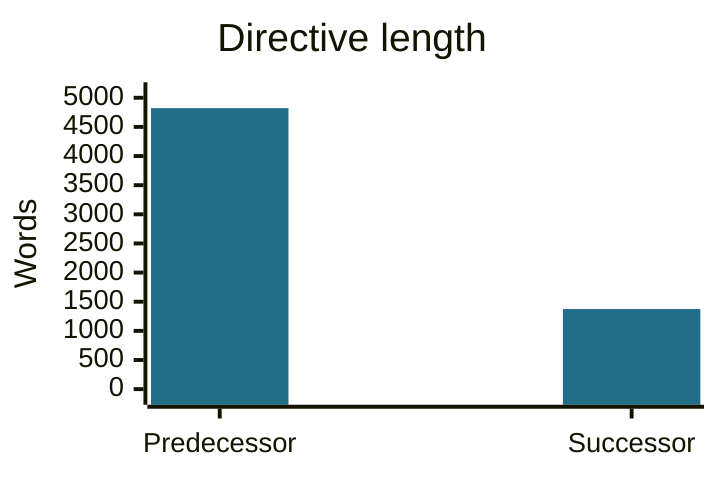
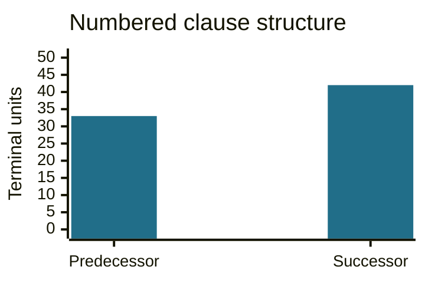
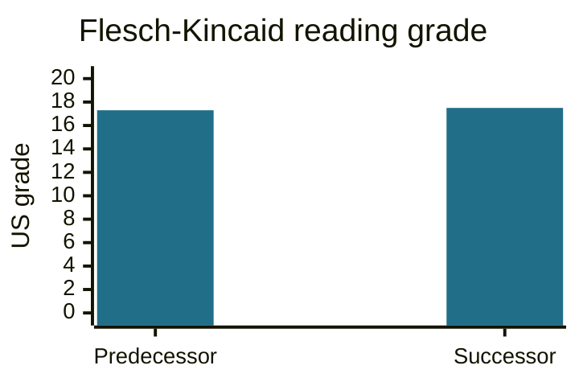
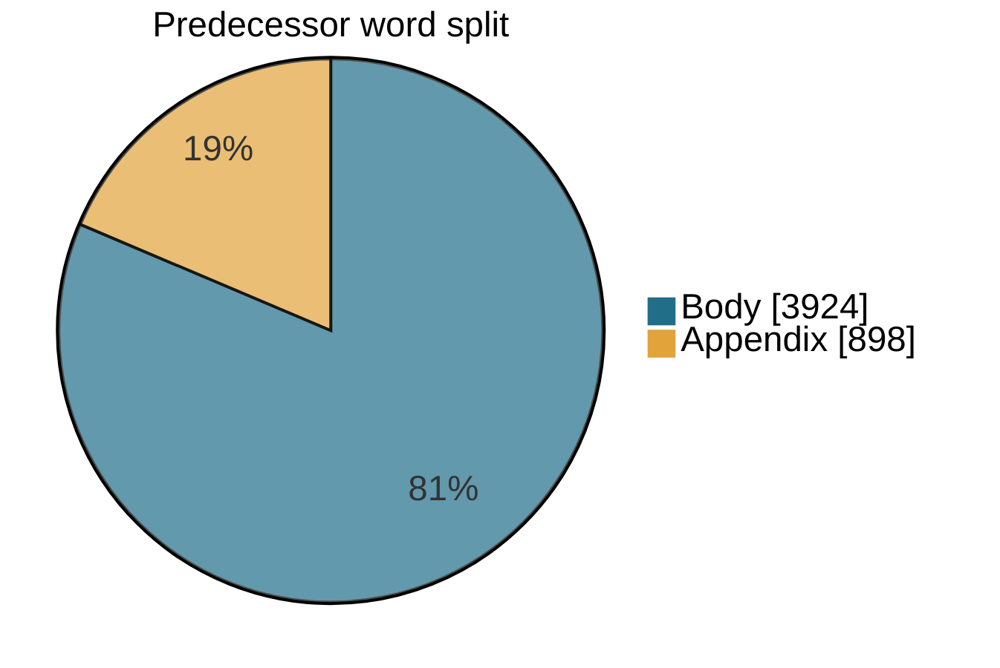

# Regulatory competitiveness and red tape reduction: a change in how the federal regulatory system is steered

**Cabinet Directive on Regulatory Competitiveness and Red Tape Reduction** 
**Published:** 2026-10-21 · **Effective:** 2026-12-31 · **Analysis as of:** 2026-10-22 
**Status:** Announced; the Cabinet Directive on Regulation remains In Force before the transition. 
**Issue:** [#527](https://github.com/PatLittle/TBS-Policy-Hawk/issues/527) 
**Analysis:** Written and reviewed by the Codex agent from the full directive, predecessor, official announcement, and Q2/Q3 repository evidence. This is strategic and implementation analysis, not a textual diff or an official government interpretation.

🚨 This personal-project analysis is a starting point for understanding the direction and its implications. It is not official guidance, legal advice, proof of realized savings, or a substitute for the operative instruments and supporting TBS direction.

## The central finding

Cabinet is changing the centre of gravity of federal regulatory management. The 2018 framework already connected regulation with public protection, evidence, transparency and a competitive economy. Its successor makes competitiveness and the reduction of unnecessary regulatory burden more explicit management commitments: a dedicated competitiveness assessment, a quantified burden-offset direction, specified review intervals, and a qualified preference for recognized standards. The strategic change is therefore more than a shorter document, but less than a general authorization to relax protections. [New directive, sections 1–4](https://www.canada.ca/en/government/system/laws/developing-improving-federal-regulations/red-tape-reduction-office/regulatory-reform-reduce-red-tape/cabinet-directive-regulatory-competitiveness-red-tape-reduction.html); [predecessor, sections 3–7](https://www.canada.ca/en/government/system/laws/developing-improving-federal-regulations/requirements-developing-managing-reviewing-regulations/cabinet-directive-regulation.html).

The implied test for regulators becomes more demanding in two directions: explain why intervention is needed and proportionate, and show how the regulatory system remains understandable, competitive and economical to navigate over time. Removing friction is itself an expected result, alongside public-interest protection. This is an analytical reading of the stated objectives, not evidence that the expected economic benefits have already occurred.

The shorter successor also changes where practitioners must look. The directive gives the national policy direction; TBS is to provide policies, guidance, tools and processes across the regulatory life cycle. The [October 21 announcement](https://www.canada.ca/en/treasury-board-secretariat/news/2026/10/government-of-canada-launches-new-directive-to-reduce-red-tape-and-strengthen-competitiveness.html) expressly says supporting resources will follow and key good-regulatory-practice obligations continue. Missing detail in the new document is therefore not sufficient evidence that the underlying obligation disappears.

## Quantitative comparison: a shorter framework, not simpler vocabulary

The successor contains **1,374 words versus 4,822** in the predecessor's directive prose: **3,448 fewer words, a 71.5% reduction**. Yet its estimated Flesch–Kincaid reading grade is **17.5 versus 17.3**. It is much shorter to read, but the vocabulary and sentence structure remain demanding. Both scores are around postsecondary level on the US grade scale; the small difference does not establish a meaningful deterioration in comprehension.

| Measure | Predecessor: Cabinet Directive on Regulation | Successor: Regulatory Competitiveness and Red Tape Reduction | Interpretation |
|---|---:|---:|---|
| Words, including institutional appendix | 4,822 | 1,374 | Down 71.5%; supporting resources are outside this comparison. |
| Clauses, defined as terminal numbered units | 33 | 42 | Up 9; the numbering systems differ, so this is a structural count, not nine additional obligations. |
| Numbered units at all levels | 41 | 54 | Includes parent section/principle labels; do not add this row to the terminal count. |
| Flesch–Kincaid grade, estimated | 17.3 | 17.5 | Both use specialist language; shorter does not necessarily mean easier. |
| Average words per sentence, block-adjusted | 21.2 | 19.9 | Shorter sentence units partly offset the successor's greater syllables per word. |
| Words in the institutional appendix | 898 | 0 | The predecessor's appendix is 18.6% of its prose. Its absence does not establish removal of those institutions' duties. |

### Four small views of the document change

**Length — words in directive prose.**

**Structure — terminal numbered clauses, not a count of duties.**

**Reading demand — estimated US grade level.**

**Predecessor composition — where some of the length sat.** This pie partitions the predecessor's words; it does not imply that any words or obligations were retained or repealed. Even excluding its appendix, the predecessor has 3,924 words, versus 1,374 in the successor, a 65.0% reduction.

### Counting method and limits

These calculations use the preserved **English HTML captures of October 22, 2026**, not an assumption that the predecessor is its unamended 2018 issue. The predecessor capture includes later content, such as section 6.3. Its founding year identifies the instrument, not the vintage of every sentence.

**Words:** include prose paragraphs and list items in the numbered body sections, plus the predecessor's institutional appendix. Exclude headings, section/clause labels, page navigation, repeated tables of contents, replacement banners, footnotes, copyright and page details. Link text counts once; URLs do not count. Word tokenization uses `textstat.lexicon_count` with punctuation removal and whitespace-separated tokens, including substantive numbers; hyphenated expressions remain one token. Appendix words are a subset of the predecessor total.

**Clauses:** a terminal numbered unit is a printed section or paragraph label with no more-specific numbered descendant. For example, 4.1 is excluded if 4.1.1 exists; 3.5 is included even though it has locally numbered list items. Chapter labels ending in `.0` are normalized to their chapter number. Unnumbered appendix roles and locally restarting list numbers are excluded. This yields 33 predecessor topic units and 42 successor units, including the un-subdivided commencement section. The predecessor numbers headings, while the successor numbers paragraphs as well as headings. Consequently, neither this count nor its increase measures the number, strength or removal of enforceable duties. The full label lists are in [metrics.json](analysis/metrics.json).

**Readability:** use English `textstat` 0.7.13 with its CMU pronunciation dictionary and hyphenation fallback. Strip clause labels; treat each prose paragraph/list-item boundary as an end of a sentence unit, adding a period where needed, while retaining sentence punctuation within the block. This avoids treating a long sequence of semicolon-ended clauses as one sentence. There are 227 such detected sentence units and an estimated 10,036 syllables in the predecessor; 69 and 2,954 respectively in the successor. The [Flesch–Kincaid formula](https://github.com/textstat/textstat/blob/main/textstat/textstat.py) is `0.39 × words/sentences + 11.8 × syllables/words − 15.59`; displayed grades are rounded to one decimal. This is a block-adjusted English-text estimate, not a tested reader-comprehension result or a French reading score. Abbreviations, legal titles, list segmentation and estimated pronunciations affect it.

The [small reproduction script](analysis/measure.py) and [results with source hashes and package versions](analysis/metrics.json) make the comparison auditable. They are report evidence, not another monitoring pipeline. **The measured compression supports the interpretation of a concise governing framework; it cannot establish how much compliance work or regulatory burden will disappear.**

## National scope: what Cabinet is addressing

This is a framework for the federal regulatory system, not a sector-specific instruction or a blanket deadline for individual permits. Section 2.1 covers regulations registered, or to be registered, under section 6 of the Statutory Instruments Act and made by or with the specified Governor in Council, Treasury Board or ministerial authority. Other regulation-making authorities are strongly encouraged to apply it. References to alignment across jurisdictions do not turn this Cabinet direction into an instruction binding provincial or territorial governments.

The national problem is framed as a relationship between public protection and economic performance. Regulation can protect health, safety, security and the environment while unnecessary burden, overlap or uncertainty can impede investment and innovation. The expected results include competitiveness, proportionality, public trust, Indigenous rights and a regulatory framework that remains fit for purpose. The intended beneficiaries extend beyond a department's internal process: businesses navigating rules, people relying on protections, investors assessing predictability, and governments coordinating regulatory systems. [New directive, sections 1–2 and 4](https://www.canada.ca/en/government/system/laws/developing-improving-federal-regulations/red-tape-reduction-office/regulatory-reform-reduce-red-tape/cabinet-directive-regulatory-competitiveness-red-tape-reduction.html).

There are firm boundaries to that direction. Section 2.3 preserves applicable statutes, regulations, other government-wide instruments and international agreements; it does not itself expand authorities or fetter statutory discretion. Section 4.5 expressly addresses distinctions among First Nations, Inuit and Métis and their rights, treaties, self-government arrangements and relevant policy obligations. Cabinet's efficiency objective is to be pursued within these constraints, not used to displace them.

## Strategic approach: what changes and what continues

| Policy approach | Position in the predecessor | Direction in the successor | Strategic significance |
|---|---|---|---|
| Competitiveness as a decision test | A fair and competitive economy was already a guiding principle; impact analysis and regulatory cooperation were established practices. | A dedicated assessment of competitiveness impacts, with communication of results, becomes an express priority action (3.2). | Competitiveness is made more visible in the evidence and explanation for proposals. This is a strengthening of an existing concern, not its first appearance. |
| Burden as something to manage across a portfolio | Section 5.2.4 addressed administrative burden and the statutory One-for-One Rule. | Section 3.3 sets a $2 offset for each $1 increase in business regulatory burden over three years, as defined by TBS. | The stated direction encourages active identification of reductions alongside new measures. Its operational scope and accounting depend on the definitions; it must not be conflated with an amendment to the existing statutory rule. |
| Regulation as an asset with an ongoing review obligation | Section 7.2 required regular stock reviews and departmental review timelines. | Section 3.5 specifies review within five years of commencement for significant-impact measures, as defined by TBS, and at least every ten years for other regulations. | Review becomes a more explicit recurring portfolio commitment rather than an unspecified periodic exercise. The text does not by itself settle transitional treatment of every existing regulation. |
| Alignment rather than unnecessary reinvention | Cooperation, possible alignment and incorporation by reference were already addressed. | Section 3.4 gives qualified default preference to recognized standards, while allowing evidence-supported adaptation in the public interest. | Canadian-specific choices require a clearer policy rationale. Neither automatic adoption of every foreign standard nor abandonment of Canadian protections follows from this wording. |
| Outcome-focused implementation | The predecessor combined guiding principles with detailed life-cycle procedures and a multi-institution appendix. | The successor concentrates direction in priorities, principles and regulator/TBS responsibilities, supported by TBS instruments (5.2.3). | The decision problem moves toward a concise governing framework plus maintained implementation resources. It does not establish that detailed obligations or other organizations' legal functions have been rescinded. |

The intended trade-off is not simply fewer rules against more protection. A proportionate, evidence-informed approach asks which requirements deliver the intended protection, which create avoidable cost or duplication, and which need redesign as technology and economic conditions change. That approach can justify retaining a demanding requirement when its risk-reduction value is established, while removing a low-value process step elsewhere. Whether institutions make those choices well is an implementation and results question, not something the directive's publication proves.

Section 2.2 also states an express mechanism for exemptions from all or part of the directive, with a requirement to consult TBS Regulatory Affairs when seeking one. The predecessor addressed pre-publication exemptions and exceptional measures in its detailed procedure. The new placement makes exemption governance more prominent and general in the text. This should be read with section 2.3 and the eventual supporting direction; it is not a general exemption from legislation or an unconstrained departmental discretion.

## What the directive signals

**Directly evidenced:** Cabinet has adopted a framework whose stated objectives connect regulatory protection with investment, innovation and competitiveness, and whose priorities include burden reductions and predictable review. The President of the Treasury Board's announcement presents it as part of the government's red-tape agenda and identifies a December 31 transition. These are stronger grounds for interpreting the instrument's policy signal than the mere fact that its text is shorter. [Official announcement](https://www.canada.ca/en/treasury-board-secretariat/news/2026/10/government-of-canada-launches-new-directive-to-reduce-red-tape-and-strengthen-competitiveness.html).

**Analytical inference:** Because the instrument is Cabinet-endorsed and addresses the regulatory system across portfolios, it provides a national political direction against which departmental choices can be examined. It gives economic and burden consequences a more explicit place in those choices. This is the Cabinet-level priority signal relevant to Prime Minister/Cabinet government; the evidence does not establish private Prime Ministerial instructions, ministers' unstated motivations, or that the instrument arose without prior public-service policy development.

**Implementation implication:** Success would require departments to manage a stock of obligations and a pipeline of proposals, not merely complete a submission checklist. A regulator proposing new measures may need an accompanying view of burdens, options, standards, review commitments and how those measures interact with other regimes. That portfolio-management interpretation follows from reading the priority actions together; the precise accounting rules and administrative processes still require TBS direction.

## Responsibilities: new work, continuing work and limits on reassignment

| Position or organization | What the source assigns | What changes in practice | What should not be inferred |
|---|---|---|---|
| Federal regulators and regulation-making organizations | Sections 3 and 5.1 assign priority actions, compliance in developing/amending/implementing/reviewing regulations, use of TBS direction, reflection of assessment findings, consultation decisions within applicable obligations, and results reporting as directed by TBS. | Dedicated competitiveness work, burden-reduction planning and timed stock review need identifiable departmental ownership. Some functions are strengthened or specified rather than wholly new. | The directive does not create a new independent regulator, transfer every function to a deputy minister, or itself supply a new statutory power. |
| Treasury Board of Canada Secretariat | Section 5.2 assigns regulatory-system oversight, advice supporting Treasury Board decisions, supporting policies/guidance/tools/processes, expert guidance and coordination, early advice on options, proposal review and regulatory innovation support. | Definitions and implementation architecture are consequential: burden accounting, significant-impact classification, evidence expectations and reporting will shape departmental execution. | Reference to delegated powers in 5.2.2 is conditional on an actual delegation by the President and its terms. It is not an unlimited new delegation made by this document alone. |
| Cabinet, Treasury Board acting as Governor in Council, or the relevant regulation-making authority | Section 2.2 identifies authorities that may provide exemptions; section 4.3.3 addresses significant-impact pre-publication or an exemption through the relevant authority. | Departments need to distinguish their own process choices from decisions reserved to these authorities and consult TBS where required. | A convenience decision by a departmental team is not equivalent to an exemption granted by the proper authority. |
| Ministers and the President of the Treasury Board | Ministers remain within the regulation-making scope; the President appears in the conditional delegation provision. | Ministerial regulatory portfolios will operate within the revised framework and any supporting directions. | The directive does not establish a new ministerial office, abolish existing approval roles, or replace legislation defining ministerial powers. |
| Justice, PCO, PSPC and other organizations named in the predecessor's appendix | The successor no longer repeats the detailed multi-institution appendix. Section 2.3 preserves other legal and policy instruments. | Users may need to consult other authorities rather than rely on the Cabinet directive to restate every institutional role. | Removal from this document's body does not prove that legal examination, registration, publication or other statutory responsibilities were removed or transferred to TBS. |
| Departmental legal, Indigenous-relations, analytical and programme specialists | Their work supports the substantive requirements and preserved obligations, including assessment and consultation. Some roles are implementation implications rather than newly named posts in the directive. | Proposed preparation is to clarify how these functions support regulatory evidence and review planning, and where current supporting policy governs. | An implementation recommendation in this report is not itself a Cabinet-created job assignment or new mandatory procedure. |

There is no newly constituted Cabinet committee, national agency or dedicated oversight office in this text comparable to the machinery sometimes created by other Cabinet directives. The change is principally the direction given to existing regulators and TBS, and the evidence, choices and portfolio practices through which they carry it out.

## Required actions and the question of removed obligations

**Direction established for commencement on December 31:** regulators are to undertake and communicate dedicated competitiveness assessment results, address the burden-offset direction, consider qualified default use of recognized standards, review regulations on the specified schedules, and remove outdated or inactive regulations as quickly as possible while respecting their mandates. They must work within the preserved authorities and obligations and follow supporting TBS policies and guidance. [New directive, sections 3–5](https://www.canada.ca/en/government/system/laws/developing-improving-federal-regulations/red-tape-reduction-office/regulatory-reform-reduce-red-tape/cabinet-directive-regulatory-competitiveness-red-tape-reduction.html).

**What is not proved to have ended:** the predecessor's detailed GBA+ language, named consultation periods, analytical procedures and institutional appendix are not all reproduced in the successor. The official announcement's continuity statement is material evidence against treating this shortening as a wholesale withdrawal of good regulatory practice. Applicable legislation, international commitments and separate policies remain relevant. Before stopping a specific step, identify its operative authority, check the supporting resources and obtain the responsible interpretation. This report does not conclude that every old clause survives unchanged; it concludes that omission from the new text is insufficient to establish rescission.

**What may need confirmation rather than assumption:** whether existing departmental review schedules meet the new approach; how current regulations enter the specified review cycle; what costs count toward the new burden direction; how credits, timing and attribution work; what makes a measure significant-impact; and what constitutes adequate communication of competitiveness findings. The announcement says resources are forthcoming. Their exact contents are not established by the captured directive and announcement.

## Operational and tactical consequences

The following is a **recommended preparation plan**, not an additional mandatory Cabinet timetable or a set of already-published TBS forms.

| Work area | Practical preparation | Owner to identify locally | Evidence or clarification needed |
|---|---|---|---|
| Proposal pipeline | Identify upcoming proposals affected by the transition and where competitiveness analysis must inform options and decisions. | Departmental regulatory-policy lead with programme sponsors. | Applicable transition and assessment guidance; the directive does not specify a universal cut-over rule for all proposals already underway. |
| Burden portfolio | Identify plausible reductions and document baselines and assumptions alongside expected new burdens. | Regulatory and economic-analysis functions. | TBS's coverage, valuation and attribution rules before claiming offset compliance or savings. |
| Standards choices | Record recognized standards considered and why adoption or Canadian adaptation is appropriate. | Technical policy specialists with legal and programme input. | Evidence on outcomes, risk, accessibility of incorporated material, language and other applicable legal obligations. |
| Stock review | Inventory regulations, known concerns and existing review commitments; identify likely significance and scheduling questions. | Regulatory programme owners. | Significant-impact definition, transition treatment and authoritative scheduling rules. |
| Consultation and rights | Keep applicable consultation, treaty, Indigenous and international obligations visible in proposal planning. | Regulatory leads, legal and Indigenous-relations specialists. | Continuing legal/policy requirements and the forthcoming resources, rather than an inference from shorter drafting. |
| Oversight and results | Decide what management needs to know about implementation readiness and eventual effects. | Departmental executives and TBS counterparts, within assigned roles. | Reporting direction, credible measures and evidence separating process completion from actual burden or outcome effects. |

### Three practical decision examples

**A new reporting requirement for businesses.** The policy team should establish the public-interest outcome and consider non-regulatory options before fixing a preferred regulatory design. It would need the dedicated competitiveness assessment and, where covered by TBS definitions, a view of the new burden and recognized reductions over the specified period. The offset direction does not authorize abandoning a statutory reporting obligation, automatically count internal departmental efficiency as business savings, or supply the accounting method. Those are separate authority and methodology questions.

**Choosing between an established standard and a Canada-specific rule.** The new direction favours consideration and, where appropriate, default adoption of recognized standards. The practical question becomes whether a common standard achieves the intended outcome in the Canadian context and meets applicable obligations. A department may have evidence supporting adaptation; default preference is not a prohibition on justified differences. Alignment should be assessed as an outcome and burden decision, not just as a citation-editing exercise.

**Reviewing a mature regulatory programme.** A team should examine whether the rules remain effective, create unintended barriers or can be simplified, and what review schedule and classification apply. A review is not automatically a decision to repeal. A proportionate response could retain an effective protection while changing a duplicative process. This differs from treating a periodic review as a one-off compliance exercise with no connection to the proposal pipeline or business experience.

## Relating the directive to Q2 and Q3 policy evolution

The preceding quarter is **FY 2026–27 Q2, July–September**; the active quarter is **Q3, October–December**. The relationships below use their actual report entries. They distinguish concrete overlap from thematic interpretation. The older Cabinet Directive inventory captures are not counted as Q3 changes.

| Repository evidence | Specific development | Relationship to this Cabinet direction | Limit on the inference |
|---|---|---|---|
| [Q2, real property, #267](../../../PolicyEvolution2026-27Q2.md#2026-07-24--management-of-real-property-directive-on-the) and [investment policy, #266](https://github.com/PatLittle/TBS-Policy-Hawk/issues/266) | Housing-related disposal flexibility and consequential investment-policy adjustments permit specified transactions to proceed under revised justification/valuation conditions. | Thematic alignment: using targeted flexibility to support a stated public purpose rather than retaining one process for every transaction. | These are different instruments and transaction regimes. The October Cabinet directive did not cause the July amendments or replace their valuation and due-diligence conditions. |
| [Q2, real property, #520](https://github.com/PatLittle/TBS-Policy-Hawk/issues/520) and [Q3 implementation notice, #524](https://github.com/PatLittle/TBS-Policy-Hawk/issues/524) | Sequential collection of public-purpose interests can shorten some disposal processes; the PIN makes departmental rationale, priorities and documentation explicit. | A useful operational analogy: discretion and faster processing still require a defensible choice and preserved safeguards. | Public-purpose interest collection is not a general exemption from Indigenous or official-language consultation. Nor is this real-property procedure a regulatory burden offset under the new directive. |
| [Q2, projects and programmes, #269](https://github.com/PatLittle/TBS-Policy-Hawk/issues/269) | Cost-estimate ranges, credibility information and supporting summaries become more explicit approval evidence; thresholds and approval sequence are unchanged. | A counterweight to a simple “less process everywhere” story: some governance needs better evidence to expose uncertainty and affordability risks. The Cabinet framework likewise retains proportionate impact/risk analysis. | The new regulatory direction does not remove Treasury Board project-approval evidence requirements or turn financial uncertainty into regulatory burden credits. |
| [Q2, procurement, #271](https://github.com/PatLittle/TBS-Policy-Hawk/issues/271) | Higher DFO-specific Small Craft Harbour contracting limits, clearer approval references and delegation constraints. | Thematic alignment with moving suitable decisions through a more tailored authority framework while keeping its boundaries visible. | A programme-specific contracting limit is not a national regulatory exemption or proof that all approval thresholds are being relaxed. |
| [Q2, digital talent, #261](https://github.com/PatLittle/TBS-Policy-Hawk/issues/261) | Removal of named platform references leaves central pool checks, the questionnaire and the pre-contracting confirmation obligation in place. | A direct interpretive lesson: a changed implementation channel does not establish that the underlying obligation has ended. Apply the same care to detail absent from the shorter Cabinet directive. | Digital talent sourcing is not the regulatory system; this is an analogy about continuity of obligations, not evidence of a common amendment programme. |
| [Q3, frontier-AI cyber readiness, #521](https://github.com/PatLittle/TBS-Policy-Hawk/issues/521) | Critical-service prioritization, inventories, defensive controls and tested recovery receive explicit direction; the captured notice includes a November 30 EPM submission deadline. | Shows why competitiveness and reduced friction must coexist with resilient services and risk-based controls. The observed policy direction includes stronger safeguards where threats warrant them. | No evidence connects this deadline to the October 21 directive. The Cabinet directive does not waive security obligations or its own directive-wide legal boundaries. |
| [Q3, HR information notices, #525](https://github.com/PatLittle/TBS-Policy-Hawk/issues/525) and [#526](https://github.com/PatLittle/TBS-Policy-Hawk/issues/526) | One update is a contact-link change; another contains a possible inconsistency about the application channel. | A caution against reading every detected edit as a strategic reform or confidently treating a removed sentence as withdrawal of a process. | These notices do not substantiate a national red-tape programme, a changed benefit entitlement or a measured reduction in administrative burden. |

The combined reading is **selective friction reduction with visible accountability**, not uniform relaxation. Q2 contains flexibility in property and contracting, but also stronger project-cost evidence. Q3 includes an operational explanation of property discretion and more demanding security preparation. Against that background, the Cabinet directive supplies a system-level regulatory direction that makes competitiveness and burden more explicit while preserving other obligations. This is a synthesis of the recorded pattern, not a claim that all these changes were centrally planned together.

## Open government, open standards and reusable public evidence

The strongest connection to **open.canada.ca** is the combination of public scrutiny and reporting with reusable evidence. The successor addresses communication of competitiveness assessments (3.2), public scrutiny and transparent engagement (4.3–4.3.1), and public reporting, forward plans and digital participation (4.4.4). The predecessor already required openness, consultation and publication, including annual review plans in section 7.2. The change therefore reinforces an existing transparency theme within the competitiveness framework; it does not introduce transparency for the first time. [Successor, sections 3–4](https://www.canada.ca/en/government/system/laws/developing-improving-federal-regulations/red-tape-reduction-office/regulatory-reform-reduce-red-tape/cabinet-directive-regulatory-competitiveness-red-tape-reduction.html); [predecessor, sections 3, 4.1.1, 5.4 and 7.2](https://www.canada.ca/en/government/system/laws/developing-improving-federal-regulations/requirements-developing-managing-reviewing-regulations/cabinet-directive-regulation.html).

### What “open” can mean here

| Theme | Alignment with the directive | Concrete application to consider | Evidence boundary |
|---|---|---|---|
| Open information and transparency | Strong, explicit thematic alignment with communicating assessments, engagement and public reporting. | Publish readable assessment findings, assumptions, options, consultation summaries and review rationales, with links from plans to results. | The Cabinet directive does not name open.canada.ca as the publication destination or specify a new universal disclosure schema. |
| Open data | A practical way to make the evidence and reporting reusable, alongside the separate open-government framework. | Catalogue eligible regulatory-stock inventories, review dates, assessment inputs, service performance and burden estimates with definitions, identifiers and revision history on open.canada.ca. | A public PDF or dashboard alone does not provide structured reusable data. Privacy, confidentiality, security and release authority still determine eligibility. |
| Open source | An implementation opportunity for consistent analysis and digital tools across regulators. | Share permitted code for burden calculations, validators, schema mappings and reporting tools so assumptions can be examined and software reused. | Neither the directive nor a preference for standards creates a blanket obligation to publish software or share protected source code. |
| Public-domain data and openly licensed data | Reuse can lower collection and analysis friction when the data is suitable and lawfully reusable. | Reuse existing public data with provenance, quality checks and clear licensing instead of requesting the same information again. | Publicly viewable, openly licensed and public domain describe different conditions. The Cabinet directive does not put government data into the public domain. |
| Open standards | Strong conceptual alignment with interoperability and qualified adoption of recognized standards in 3.4 and 4.1.2. | Prefer suitable shared definitions, identifiers, schemas, formats and interfaces over incompatible departmental designs, after checking their governance and fitness. | A recognized regulatory standard is not automatically an open digital standard, free to obtain, or licensed for unrestricted implementation. The directive does not list mandatory open-data standards. |

The separate [Directive on Open Government, sections 5–6](https://publications.gc.ca/collections/collection_2018/sct-tbs/BT22-157-2014-eng.pdf) establishes the release and reuse theme; current [Service and Digital guidance, section 4.3.2.8](https://www.canada.ca/en/government/system/digital-government/guideline-service-digital.html) connects eligible departmental data/information to discovery through the designated open-government portal, subject to security, privacy and legal considerations. Together, these provide a policy basis for considering open.canada.ca when implementing regulatory transparency. This is a reading across instruments, not a new portal requirement invented from this Cabinet directive.

For reusable releases, identify the actual licence. The [Open Government Licence – Canada](https://open.canada.ca/en/open-government-licence-canada) permits broad reuse under terms including attribution; it is a licence, not a declaration that copyright has vanished. Do not assume every government webpage, third-party standard or regulatory dataset carries that licence. For software and standards reuse, the [Open Resource Exchange](https://code.open.canada.ca/en/index.html) provides a Canadian cross-government sharing venue; its [open-standards catalogue](https://code.open.canada.ca/en/open-standards.html) describes implementable formats, protocols and interfaces. These are useful implementation resources, not standards newly prescribed by this directive.

### OCDS, IATI and beneficial ownership: where the fit is strongest

**None of OCDS, IATI or BODS is named in the directive.** Their relevance lies in choosing interoperable evidence and disclosure mechanisms in the appropriate domain. Section 3.4 is a reason to assess suitable standards; it does not certify every voluntary data specification as a recognized standard under that provision, or require all regulatory programmes to adopt these three.

| Standard or data domain | What it addresses | Alignment and a useful application | What this analysis does not claim |
|---|---|---|---|
| **Open Contracting Data Standard (OCDS)** | Structured disclosure across procurement planning, tender, award, contract and implementation, linked by a contracting-process identifier (OCID). | **Adjacent-domain fit:** procurement of regulatory IT or implementation services could use lifecycle data to examine competition, amendments and delivery. Consistent identifiers and disclosures can support scrutiny while avoiding duplicate bespoke reporting. It also offers a useful model for linking plans to results. | Procurement is a different regime from regulation-making. OCDS is not a format for the regulatory stock, and this directive neither mandates OCDS nor changes contracting disclosure rules. |
| **International Aid Transparency Initiative (IATI) Standard** | Structured information about development/humanitarian activities, organizations, finances and results. Global Affairs Canada already publishes bilingual IATI data. | **Established reuse example:** common codes and structured releases show how transparency and comparability can share one data-production process. Where an international-assistance activity supports regulatory capacity or reform, its existing IATI record may provide relevant funding/results context. | IATI is not a universal regulatory reporting schema. A domestic regulatory proposal does not become an IATI activity because it concerns competitiveness; existing Canadian publication predates this directive. |
| **Beneficial ownership data and the Beneficial Ownership Data Standard (BODS)** | Data about the natural persons who ultimately own or control entities; BODS supports consistent collection and exchange. | **Integrity and coordination fit:** accurate ownership information can help eligible users understand who participates in regulated markets or receives public contracts. Shared entity identifiers and well-governed data exchange could reduce repeated collection while supporting verification and accountability. | The directive does not create ownership-disclosure duties, authorize joining restricted personal data, or prove that Canada's registries already conform to BODS. Corporate ownership and a supplier's procurement record are related but distinct data. |

Sources for those domain descriptions are the [OCDS lifecycle primer](https://standard.open-contracting.org/latest/en/primer/how/), [IATI publishing guidance](https://reference.iatistandard.org/en/guidance/publishing-data/how-to-publish-data/creating-files/), [GAC's existing IATI publication](https://www.international.gc.ca/world-monde/issues_development-enjeux_developpement/priorities-priorites/initiative.aspx?lang=eng), and [BODS documentation](https://standard.openownership.org/en/latest/). The applications in the table are this report's recommendations, not commitments made by those organizations or new directive requirements.

A concrete cross-domain example is a **proposed, authorized link between a contract's supplier entity and its public beneficial-ownership record**, with the OCID identifying the contracting process and a jurisdiction-qualified entity identifier identifying the company. This could help examine related bidders or concentration; an apparent relationship is a lead for validation, not proof of collusion. If the work is also part of a reported international-assistance activity, an IATI activity identifier could connect the funding context. The identifiers serve different objects and must not be substituted for one another. Ownership changes over time, name-only matches are unreliable, and publication/lookup coverage is incomplete. Such a design requires an actual use case, a verified mapping and lawful access; it should not collect more personal information merely because a standard can represent it.

**The integrity test for red-tape reduction:** simplify duplicate filing and incompatible formats without weakening the substantive ownership information needed for accountability. Canada's [January 2024 federal registry announcement](https://www.canada.ca/en/innovation-science-economic-development/news/2024/01/minister-champagne-announces-federal-corporations-need-to-begin-filing-their-beneficial-ownership-information.html) tied corporate transparency to business confidence and described reuse of existing intake mechanisms, proportionate public disclosure and work toward pan-Canadian access. That is a concrete precedent for combining less administrative friction with stronger transparency. It is earlier evidence of alignment, not an outcome caused by the October 2026 directive or proof that pan-Canadian integration is now complete.

## Federal–provincial–territorial collaboration: a practical dependency

The successor explicitly connects standards with inter-jurisdictional alignment (3.4), interoperability through regulatory cooperation (4.1.2), and coordination to reduce overlap (4.4.2). This is **continuity with greater emphasis**, not the first federal instruction to cooperate: predecessor sections 4.2, 4.3, 5.2.5 and 6.2 already addressed alignment and coordination. A federal team can streamline its own process, but it cannot eliminate cross-border duplication by changing only its own forms. Where rules, approvals or data responsibilities span jurisdictions, compatible outcomes require participating governments and regulators to work together.

An existing mechanism is the Canadian Free Trade Agreement's **Regulatory Reconciliation and Cooperation Table**, which includes federal, provincial and territorial governments and addresses divergent regulatory frameworks and future cooperation. It is a potential route for relevant alignment work, not a body created by this directive or a mandatory channel specified for every proposal. [TBS description of Canada's regulatory cooperation activities](https://www.canada.ca/en/government/system/laws/developing-improving-federal-regulations/regulatory-cooperation/canada-regulatory-cooperation-activities.html).

| Collaboration need | Practical joint work to consider | Boundary to preserve |
|---|---|---|
| Comparable standards and recognition | Map requirements for a shared activity; agree which standards, test results or approvals can be recognized and what evidence justifies differences. | Identical wording is not necessary for compatible outcomes; a federal Cabinet directive does not compel provincial adoption or itself establish mutual recognition. |
| Reuse of reporting data | Agree common definitions, entity identifiers, validation rules, update schedules and lawful exchange arrangements before proposing “provide once, reuse.” | A common schema does not confer data-sharing authority, make private records public, or prove every jurisdiction collects the same information. |
| Beneficial-ownership interoperability | Coordinate registries' coverage, identifiers, change history, correction processes and access tiers; assess a suitable exchange model such as BODS. | Federal corporate records do not cover all provincially incorporated entities. Pan-Canadian access requires actual participation and applicable authority, not an assumption of one completed national register. |
| Public reporting and discovery | Link federal and participating provincial/territorial plans, datasets and results with clear jurisdiction and version metadata; use open.canada.ca where appropriate for federal discovery. | Publishing a federal catalogue record does not transfer ownership or control of another government's data. |
| Burden and outcome evaluation | Agree baselines and attribution so a single shared improvement is not counted independently as several different savings. | Coordination costs and differences in public-interest protections still need analysis; alignment is not automatic proof of reduced net burden. |

These are recommended implementation tasks, not additional assignments made to provincial officials by Cabinet. Indigenous governments, rights and treaty obligations require their own appropriate engagement and governance; they must not be collapsed into a federal–provincial administrative arrangement. The directive's sections 2.3 and 4.5 remain material constraints.

**Overall assessment:** the strongest alignment is with transparency, evidence reuse, interoperability and coordinated standards choices. Open data and reusable tools can make those aims practical. OCDS, IATI and BODS provide domain-specific options and precedents; each needs a justified use case and appropriate governance. A smaller number of disconnected forms is useful, but a coherent, reusable and publicly understandable evidence system would better serve both accountability and reduced friction.

## What to watch after publication

The most consequential next evidence will be the supporting TBS instruments and the way departments use them. In particular:

- How burden is defined, valued and attributed, and whether claimed reductions reflect the experience of affected businesses rather than changes in internal workload alone.
- How significant-impact classification and review schedules apply to existing stock and to proposals in transition.
- How continuing good-regulatory-practice obligations are expressed in the new supporting architecture, including analytical, consultation and institutional requirements omitted from the shorter text.
- Whether competitiveness findings materially affect options and decisions, and whether public communication explains trade-offs rather than only announcing a favourable conclusion.
- Whether implementation produces more predictable, effective regimes while maintaining protection, Indigenous rights and other obligations. Publication and preparation are not evidence of those results.

At December 31, verify commencement and the authoritative state of the instruments before marking the predecessor Superseded. A later routine amendment or source-availability change should receive proportionate ordinary analysis; it should not automatically create another report of this kind.

## Sources and evidence

1. [Full successor directive](https://www.canada.ca/en/government/system/laws/developing-improving-federal-regulations/red-tape-reduction-office/regulatory-reform-reduce-red-tape/cabinet-directive-regulatory-competitiveness-red-tape-reduction.html): [archived Markdown](captures/20261022/current.md), [HTML](captures/20261022/current.html), [screenshot](captures/20261022/current.png).
2. [Cabinet Directive on Regulation](https://www.canada.ca/en/government/system/laws/developing-improving-federal-regulations/requirements-developing-managing-reviewing-regulations/cabinet-directive-regulation.html): [comparison source](captures/20261022/previous.md), [HTML](captures/20261022/previous.html), [screenshot](captures/20261022/previous.png). This is the valid repository predecessor capture available for the analysis, not an assertion that no intervening external revision ever occurred.
3. [October 21 official announcement](https://www.canada.ca/en/treasury-board-secretariat/news/2026/10/government-of-canada-launches-new-directive-to-reduce-red-tape-and-strengthen-competitiveness.html): [archived text](captures/20261022/announcement.md), [HTML](captures/20261022/announcement.html). Its publication and continuity statements inform the transition analysis.
4. [Quantitative evidence](analysis/metrics.json), [reproduction script](analysis/measure.py), and the primary open-government/standards sources cited in the analytical sections above. Metrics refer to the archived English bodies, not supporting-policy suites.
5. [Q2 Policy Evolution](../../../PolicyEvolution2026-27Q2.md) and [Q3 Policy Evolution](../../../PolicyEvolution2026-27Q3.md), with specific issue references above. These are this project's analyses, not official statements; their evidence limitations remain applicable.

**Record boundaries:** The deep dive concerns the instrument published on October 21. The September 2018 directive and the other older collection baselines are context/evidence, not new Q3 publications. No raw file diff is required to understand this report, and no claim is made about realized savings, repealed statutes or private political intent.
